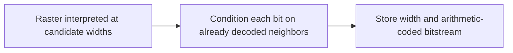
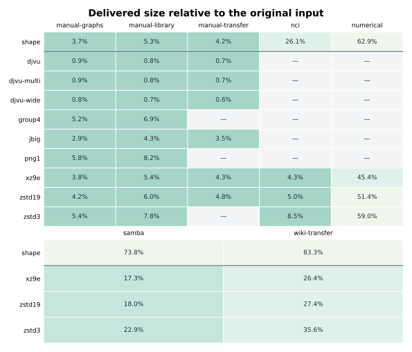

# Raster shape search with an actual range-coded archive

> **Verdict: loses on real data.** Best real input: Silesia numerical files (mr + x-ray + sao), +38.6% vs xz -9e.
>
> On the complete Canterbury fax file `ptt5` (513,216 B): **28,037 B**, better than CCITT Group 4 (32,344) and xz -9e (39,868) but worse than JBIG (25,917) and lossless DjVu (22,490); cmix, published: 21,883.
>
> Part of [chapter 4](../../report/4-specialised.md) of the [report](../../report/README.md). Terms: [glossary](../../report/glossary.md).

## Question

A fax page is a grid of black and white pixels. Can a model that finds the row width and predicts each pixel from its neighbours beat the fax standards?

## How it works



The coder detects the row width, then range-codes each bit with a context made of nearby pixels in the same and previous rows.

<details><summary>Technical details</summary>

The old search in `lab/shapes2/shapesearch.py` found a 1,729-bit row and a useful neighborhood on the Canterbury fax. Its 29,745-byte result was an estimated description and sequential code length. SCX1 uses this observation, encodes the bits with the original Statico range coder, and decodes them from the archive alone.

**Mechanism and test.** The right stride puts nearby pixels into a causal context. A wrong stride feeds the coder unrelated neighbors. Manual rasters and ordinary byte streams test the importance of a meaningful row geometry.

The history baseline sees the previous two bits. The original stencil uses the previous bit, two neighbors above and to the right, and the bit directly above two rows back. The larger stencil uses two preceding bits, five neighbors in the previous row, and one two rows back. Both sides traverse the input MSB-first, initialize each context with one count for each outcome, and update and periodically halve the counts identically.

The encoder tries widths 1,728 and 1,729 and up to three additional widths selected by sample conditional entropy from widths up to 2,048. It writes the smallest actual payload among these models, the history baseline and literal bytes. Its 15-byte header records magic, length, row width and model. A selected width is a predictor parameter and can span a record or part of a row.

</details>

## Results on 20 MiB inputs

Every archive below decoded byte-exact. *Our archive* is this project's own format. *Our transform → standard tool* reshapes the bytes reversibly and hands the result to gzip, zstd or xz; it is listed only where it beats that same tool on the raw bytes. *Best standard tool* is the smallest of gzip, bzip2, xz, Zstandard, Brotli and PPMd (plus domain codecs for images, scans and video) on the raw bytes. *Difference* compares the better of our two columns with it; negative = ours is smaller.

| Input | Kind | Raw bytes | Our archive | Our transform → standard tool | Best standard tool | Difference |
|---|---|---:|---:|---:|---:|---:|
| Scanned manual: Graphviz guides | real | 24,642,792 | 901,604 (`shape`) | — | 191,132 (DjVu) | 4.7× larger |
| Scanned manual: Graphviz library | real | 24,283,584 | 1,283,911 (`shape`) | — | 175,164 (DjVu) | 7.3× larger |
| Scanned manual: NASM | real | 31,809,024 | 1,331,683 (`shape`) | — | 189,610 (DjVu) | 7.0× larger |
| Silesia nci (chemical database) | real | 33,553,445 | 8,743,426 (`shape`) | — | 1,449,272 (xz -9e) | 6.0× larger |
| Silesia numerical files (mr + x-ray + sao) | real | 25,696,748 | 16,165,523 (`shape`) | — | 11,662,476 (xz -9e) | +38.6% |
| Silesia samba (source tarball) | real | 21,606,400 | 15,955,462 (`shape`) | — | 3,739,524 (xz -9e) | 4.3× larger |
| Wikipedia text, another 24 MiB | real | 25,165,824 | 20,974,546 (`shape`) | — | 6,637,336 (xz -9e) | 3.2× larger |

<details><summary>All profiles, timings and entropy measurements</summary>

<!-- BEGIN generated project measurements -->

Each archive passed a byte-for-byte round trip. *Bytes saved* is raw size minus archive (and any reference the decoder needs). Timings are one run on a shared desktop.

These tables list every measured profile. The comparison with the best standard tool on each input (gzip, bzip2, xz, Zstandard, Brotli, PPMd and the domain codecs) is the Results table above.

### Archive comparison across inputs



Read down a column to compare methods on identical input. Lower is better. 100% is the raw file size. Where available, standard codecs appear below the dividing line. Near 100%, cells give the exact byte difference from raw (+ means larger). Below 0.1%, they give the exact delivered total. A dash means the combination was unmeasured.

This project's published large-file trials measure complete archives. The effect on gzip, Zstandard or XZ after an isolated preprocessing step is unmeasured here.

### manual-graphs · 24,642,792 raw bytes

**Standalone archives**

| Profile | Archive bytes | Bytes saved vs raw | Encode (s) | Decode (s) |
|---|---:|---:|---:|---:|
| `shape` | 901,604 | +23,741,188 | 104.488 | 13.904 |

Same-input baseline archives (bytes) · DjVu 214,067 · DjVu (separated foreground) 213,732 · DjVu (wide strips) 191,132 · CCITT Group 4 1,270,850 · JBIG 707,797 · 1-bit PNG 1,418,635 · XZ 9 extreme 930,864 · Zstandard 19 1,034,431 · Zstandard 3 1,325,134

[Input hash and all measured codecs](../large-scale/results/by-dataset.md#manual-graphs)

### manual-library · 24,283,584 raw bytes

**Standalone archives**

| Profile | Archive bytes | Bytes saved vs raw | Encode (s) | Decode (s) |
|---|---:|---:|---:|---:|
| `shape` | 1,283,911 | +22,999,673 | 142.515 | 27.266 |

Same-input baseline archives (bytes) · DjVu 202,780 · DjVu (separated foreground) 202,666 · DjVu (wide strips) 175,164 · CCITT Group 4 1,678,602 · JBIG 1,049,864 · 1-bit PNG 1,996,848 · XZ 9 extreme 1,304,420 · Zstandard 19 1,457,017 · Zstandard 3 1,903,366

[Input hash and all measured codecs](../large-scale/results/by-dataset.md#manual-library)

### manual-transfer · 31,809,024 raw bytes

**Standalone archives**

| Profile | Archive bytes | Bytes saved vs raw | Encode (s) | Decode (s) | Peak KiB (encode / decode) |
|---|---:|---:|---:|---:|---:|
| `shape` | 1,331,683 | +30,477,341 | 178.463 | 37.689 | 72,856 / 38,392 |

Same-input baseline archives (bytes) · DjVu 213,659 · DjVu (separated foreground) 213,655 · DjVu (wide strips) 189,610 · JBIG 1,108,897 · XZ 9 extreme 1,354,964 · Zstandard 19 1,525,436

[Input hash and all measured codecs](../large-scale/results/by-dataset.md#manual-transfer)

### nci · 33,553,445 raw bytes

**Standalone archives**

| Profile | Archive bytes | Bytes saved vs raw | Encode (s) | Decode (s) |
|---|---:|---:|---:|---:|
| `shape` | 8,743,426 | +24,810,019 | 66.023 | 9.544 |

Same-input baseline archives (bytes) · XZ 9 extreme 1,449,272 · Zstandard 19 1,664,988 · Zstandard 3 2,835,400

[Input hash and all measured codecs](../large-scale/results/by-dataset.md#nci)

### numerical · 25,696,748 raw bytes

**Standalone archives**

| Profile | Archive bytes | Bytes saved vs raw | Encode (s) | Decode (s) |
|---|---:|---:|---:|---:|
| `shape` | 16,165,523 | +9,531,225 | 57.991 | 9.894 |

Same-input baseline archives (bytes) · XZ 9 extreme 11,662,476 · Zstandard 19 13,213,336 · Zstandard 3 15,163,683

[Input hash and all measured codecs](../large-scale/results/by-dataset.md#numerical)

### samba · 21,606,400 raw bytes

**Standalone archives**

| Profile | Archive bytes | Bytes saved vs raw | Encode (s) | Decode (s) |
|---|---:|---:|---:|---:|
| `shape` | 15,955,462 | +5,650,938 | 37.734 | 5.418 |

Same-input baseline archives (bytes) · XZ 9 extreme 3,739,524 · Zstandard 19 3,894,675 · Zstandard 3 4,957,768

[Input hash and all measured codecs](../large-scale/results/by-dataset.md#samba)

### wiki-transfer · 25,165,824 raw bytes

**Standalone archives**

| Profile | Archive bytes | Bytes saved vs raw | Encode (s) | Decode (s) |
|---|---:|---:|---:|---:|
| `shape` | 20,974,546 | +4,191,278 | 50.864 | 7.656 |

Same-input baseline archives (bytes) · XZ 9 extreme 6,637,336 · Zstandard 19 6,891,038 · Zstandard 3 8,968,456

[Input hash and all measured codecs](../large-scale/results/by-dataset.md#wiki-transfer)

### Reproduce the large-file comparison

From the repository root, with the pinned inputs and project dependencies installed, replay all published standalone profiles for this folder into a fresh directory.

```sh
python3 research/large-scale/primary.py runs/replay-shape-context --project shape-context --all-profiles
```

[Dataset preparation](../large-scale/README.md#inputs) · [Archive hashes and settings](../large-scale/results/archives.jsonl)

<!-- END generated project measurements -->

</details>

## Small-scale results

The primary trial measures `shape` on the complete `manual-graphs` input (24,642,792 raw bytes). The runner invokes a separate decoder and compares the reconstructed file byte for byte. The earlier measurements below retain their original input sizes.

| Input | History only | Shape search | Zstandard 3 | XZ extreme |
|---|---:|---:|---:|---:|
| Canterbury ptt5, 513,216 bytes | 61,788 | **28,037** | 54,421 | 39,860 |
| Rule 30 at width 257, 65,792 bytes | 16,942 | **156** | 12,565 | 12,020 |
| Canterbury kennedy.xls, 1,029,744 bytes | 625,246 | 95,150 | 111,828 | **51,868** |
| enwik8, first MiB | 1,025,100 | 873,471 | 364,070 | **302,792** |

On the fax the eight-tap model chose width 1,729. Its complete archive is 11,823 bytes smaller than XZ on this file. The fax informed the design. On the Rule 30 control the width selector recovered 257. The random control selected literal bytes. [Archive rows and hashes](results/trials.csv)

For a fax-specific comparison, Pillow encoded the same bits as a 1,728 × 2,376 monochrome image. A CCITT Group 4 TIFF with a single white-is-zero strip used 32,344 bytes, a default Group 4 TIFF used 33,316, and a 1-bit PNG used 53,277. All decoded to the original packed bytes. SCX1 saved 4,307 bytes over the smaller TIFF. Its selected 1,729-bit predictor stride differs from the actual image width by one bit. Pillow with libtiff support is optional and used only by this baseline script. [Image-container results](results/fax-containers.csv)

After fixing the codec, a separate check took every matching gzip-compressed PSF font in the local Linux console-font directory, decompressed each in full and eliminated byte-identical duplicates by SHA-256. The 134 distinct files include headers, glyphs and Unicode tables. Each file was encoded and decoded separately. Combined input was 748,915 bytes. Summed archive sizes were 362,124 with SCX1, 324,801 with Zstandard and 267,744 with XZ. SCX1 beat Zstandard on five fonts and XZ on zero. The fax result does not generalize across this collection. [Font-by-font results](results/fonts/trials.csv)

## Run it

The [28,037-byte archive](results/ptt5.scx) is included. With the native engine built, the following command restores the complete fax without a corpus checkout.

```sh
mkdir -p runs
research/build/shape decode research/shape-context/results/ptt5.scx runs/canterbury-fax.bin
```

```sh
mkdir -p runs
research/build/shape encode "$CORPUS/canterbury/ptt5" runs/fax.scx
research/build/shape decode runs/fax.scx runs/fax.restored
cmp "$CORPUS/canterbury/ptt5" runs/fax.restored
python3 research/shape-context/benchmark.py "$CORPUS" runs/raster
python3 research/shape-context/fax_baselines.py "$CORPUS/canterbury/ptt5" runs/fax-containers.csv
python3 research/shape-context/benchmark.py /usr/share/kbd/consolefonts runs/font-check --fonts
```
