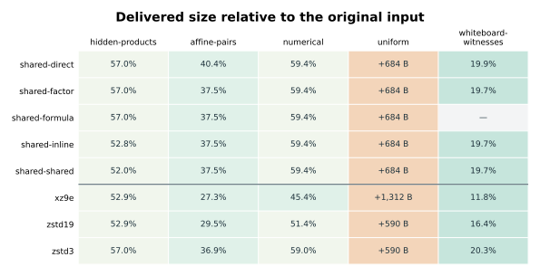
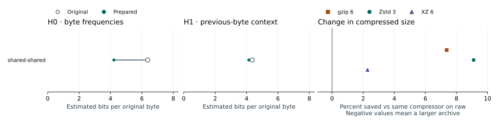

# Shared formulas inside a factor tree

[Method diagram](#method-diagram) · [Charts and benchmark tables](#large-file-benchmark)

## Question and prior work

Can an exact ratio from the 2019 whiteboard become useful after dividing a word and cutting its cofactor at a bit boundary? Can several words pay for the same formula once?

### Source files and compatibility

The recipe dictionary and inverse follow the [whiteboard implementation](../whiteboard-trees/README.md), originally from `lab/hutter/ragc/entropy_base_tree`. SFF1 is a new page format. It encodes the shared divisor and widths explicitly.

## Run the experiment

Run these commands from the repository root. The [large-suite instructions](../large-scale/README.md) give input preparation, dependencies and the complete benchmark command.

```sh
mkdir -p runs
python3 research/shared-factor-forest/codec.py encode runs/large/raw/hidden-products runs/products.sff --profile shared
python3 research/shared-factor-forest/codec.py decode runs/products.sff runs/products.restored
cmp runs/large/raw/hidden-products runs/products.restored
```

## Variants and format

Each 256 KiB page can store direct bytes, Zstandard 3, a split after a common factor, an inline formula, or an indexed formula dictionary. Candidate widths are 16, 32 and 64 bytes. For an exact factor of x + δ, the decoder joins the two cofactor children, multiplies, then subtracts δ. The page pays for the exceptions, recipe book, references, little integer fields, literal lanes, and tail. Formula-aware search uses sampled recipe hits to shortlist divisors. The factor-only profile ranks divisors without that signal.

### Method diagram


**Mechanism and test.** The hidden-product plant contains a formula child and a random child. Factoring exposes the first, and reuse amortizes its description. Inline and shared coding tie on the numerical input, so the dictionary saving is input-dependent.

## Inputs and measurement

The planted 24 MiB stream contains independently generated words. One child of a 17-fold product is an exact repunit quotient and the other has fresh random bits. The numerical stream, real affine instructions and uniform control use the same encoder.

## Results

Direct, factor-only and formula-only all gave 14,336,766 bytes on the plant. Inline composition gave 13,286,101. Sharing gave 13,097,327, beating inline by 188,774 and whole-file XZ extreme by 212,461. On the numerical data the shared and inline results tied at 15,271,526. On uniform data every profile tied at 25,166,508. [Full archive sizes, times and hashes](../large-scale/results/by-dataset.md)


## Large-file benchmark

On `hidden-products` (25,165,824 raw bytes), `shared-shared` produced 13,097,327 archive bytes. Zstandard level 3 used 14,343,987 bytes on the same input. [Input and timing](../large-scale/results/by-dataset.md#hidden-products) · [All project measurements](../large-scale/results/by-experiment.md#shared-factor-forest)

On the generated hidden products, the full representation before a standard compressor occupied 13,379,724 bytes from 25,165,824 raw bytes. Its byte entropy increased from 6.374 to 7.928 bits per byte. Accounting for its shorter length gives 4.215 post-transform H0 bits per original byte. Whole-stream Zstandard 3 shrank from 14,343,986 to 13,038,675 bytes. [Matched preprocessing measurements](../large-scale/results/preprocessing.md)

<!-- BEGIN generated project measurements -->

Each archive passed a byte-for-byte round trip. Bytes saved subtracts the archive and any required reference from the raw input size. Timings are seconds from one run.

On the primary input `hidden-products`, `shared-shared` delivers 13,097,327 bytes, 1,246,660 bytes smaller than standalone Zstandard 3 (14,343,987 bytes).

Holding `shared-shared` fixed across the 5 measured input/reference settings with a standalone Zstandard 3 control gives **2 smaller, 0 equal and 3 larger** delivered archives. Each setting counts once.

### Archive comparison across inputs



Read down a column to compare methods on identical input. Lower is better. 100% is the raw file size. Where available, standard codecs appear below the dividing line. Near 100%, cells give the exact byte difference from raw (+ means larger). Below 0.1%, they give the exact delivered total. A dash means the combination was unmeasured.

The paired figures below measure preprocessing separately. H0 measures byte frequencies. H1 conditions on the previous byte. The tables give both in bits per byte of their own stream. The figures express model costs per original byte. H0 counts every byte. H1 counts each adjacent pair, omitting the first byte’s marginal cost. Positive compressor savings mean a smaller compressed file.

### hidden-products · 25,165,824 raw bytes



Of 1 measured profiles on this input, 1 reduced gzip size, 1 reduced Zstandard size and 1 reduced XZ size. Exact ties count separately from improvements.

**Entropy before and after preprocessing**

| Profile | Prepared bytes | H0 before → after | H1 before → after | Post H0 per raw byte |
|---|---:|---:|---:|---:|
| `shared-shared` | 13,379,724 | 6.3745 → 7.9279 | 4.3616 → 7.7994 | 4.2150 |

**Same compressor on original → prepared bytes**

| Profile | gzip 6 | Zstandard 3 | XZ 6 |
|---|---:|---:|---:|
| `shared-shared` | 14,118,577 → 13,077,821 (+7.37%) | 14,343,986 → 13,038,675 (+9.10%) | 13,314,968 → 13,011,616 (+2.28%) |

**Standalone archives**

| Profile | Archive bytes | Bytes saved vs raw | Encode (s) | Decode (s) |
|---|---:|---:|---:|---:|
| `shared-direct` | 14,336,766 | +10,829,058 | 0.283 | 0.147 |
| `shared-factor` | 14,336,766 | +10,829,058 | 18.808 | 0.134 |
| `shared-formula` | 14,336,766 | +10,829,058 | 18.963 | 0.357 |
| `shared-inline` | 13,286,101 | +11,879,723 | 55.139 | 6.850 |
| `shared-shared` | 13,097,327 | +12,068,497 | 101.292 | 2.754 |

Same-input baseline archives (bytes) · XZ 9 extreme 13,309,788 · Zstandard 19 13,318,271 · Zstandard 3 14,343,987

[Input hash and all measured codecs](../large-scale/results/by-dataset.md#hidden-products)

### affine-pairs · 25,165,824 raw bytes

**Standalone archives**

| Profile | Archive bytes | Bytes saved vs raw | Encode (s) | Decode (s) |
|---|---:|---:|---:|---:|
| `shared-direct` | 10,160,796 | +15,005,028 | 1.587 | 0.546 |
| `shared-factor` | 9,445,541 | +15,720,283 | 39.486 | 6.369 |
| `shared-formula` | 9,445,541 | +15,720,283 | 35.866 | 5.845 |
| `shared-inline` | 9,445,541 | +15,720,283 | 80.511 | 7.063 |
| `shared-shared` | 9,445,541 | +15,720,283 | 132.395 | 8.254 |

Same-input baseline archives (bytes) · XZ 9 extreme 6,867,572 · Zstandard 19 7,421,335 · Zstandard 3 9,297,292

[Input hash and all measured codecs](../large-scale/results/by-dataset.md#affine-pairs)

### numerical · 25,696,748 raw bytes

**Standalone archives**

| Profile | Archive bytes | Bytes saved vs raw | Encode (s) | Decode (s) |
|---|---:|---:|---:|---:|
| `shared-direct` | 15,272,238 | +10,424,510 | 0.751 | 0.316 |
| `shared-factor` | 15,271,526 | +10,425,222 | 27.673 | 0.546 |
| `shared-formula` | 15,271,526 | +10,425,222 | 27.244 | 0.626 |
| `shared-inline` | 15,271,526 | +10,425,222 | 65.107 | 0.664 |
| `shared-shared` | 15,271,526 | +10,425,222 | 115.195 | 0.686 |

Same-input baseline archives (bytes) · XZ 9 extreme 11,662,476 · Zstandard 19 13,213,336 · Zstandard 3 15,163,683

[Input hash and all measured codecs](../large-scale/results/by-dataset.md#numerical)

### uniform · 25,165,824 raw bytes

**Standalone archives**

| Profile | Archive bytes | Bytes saved vs raw | Encode (s) | Decode (s) |
|---|---:|---:|---:|---:|
| `shared-direct` | 25,166,508 | -684 | 1.207 | 0.842 |
| `shared-factor` | 25,166,508 | -684 | 58.998 | 0.962 |
| `shared-formula` | 25,166,508 | -684 | 51.896 | 0.356 |
| `shared-inline` | 25,166,508 | -684 | 97.905 | 0.982 |
| `shared-shared` | 25,166,508 | -684 | 172.823 | 1.231 |

Same-input baseline archives (bytes) · XZ 9 extreme 25,167,136 · Zstandard 19 25,166,414 · Zstandard 3 25,166,414

[Input hash and all measured codecs](../large-scale/results/by-dataset.md#uniform)

### whiteboard-witnesses · 22,630,320 raw bytes

**Standalone archives**

| Profile | Archive bytes | Bytes saved vs raw | Encode (s) | Decode (s) | Peak KiB (encode / decode) |
|---|---:|---:|---:|---:|---:|
| `shared-direct` | 4,499,458 | +18,130,862 | 1.094 | 1.286 | 24,564 / 23,896 |
| `shared-factor` | 4,460,659 | +18,169,661 | 49.224 | 5.501 | 26,224 / 24,232 |
| `shared-inline` | 4,460,659 | +18,169,661 | 79.120 | 2.271 | 27,868 / 24,284 |
| `shared-shared` | 4,460,659 | +18,169,661 | 96.080 | 2.162 | 28,152 / 24,384 |

Same-input baseline archives (bytes) · XZ 9 extreme 2,679,352 · Zstandard 19 3,705,005 · Zstandard 3 4,602,358

[Input hash and all measured codecs](../large-scale/results/by-dataset.md#whiteboard-witnesses)

### Reproduce the large-file comparison

From the repository root, with the pinned inputs and project dependencies installed, replay all published standalone profiles for this folder into a fresh directory.

```sh
python3 research/large-scale/primary.py runs/replay-shared-factor-forest --project shared-factor-forest --all-profiles
```

[Dataset preparation](../large-scale/README.md#inputs) · [Archive hashes and settings](../large-scale/results/archives.jsonl)

A separate paired run also records entropy, stream hashes and the three backend sizes.

```sh
mkdir -p runs/paired
python3 research/large-scale/entropy_bench.py shared-shared runs/large/raw/hidden-products runs/paired/shared-factor-forest.json
```

[All paired stream hashes and compressor versions](../large-scale/results/preprocessing.jsonl)

<!-- END generated project measurements -->

## Connections

Experiment 01 defines the leaves, experiment 02 the factor operations and experiment 11 the shared-expression question. The [carry tree](../carry-trees/README.md) measures an alternate way of deciding where to split.
