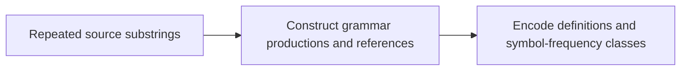

# Statico M1 grammar compressor

[Method diagram](#method-diagram) · [Charts and benchmark tables](#large-file-benchmark)

## Question and prior work

How far can an explicit grammar compress ordinary text and binary data? This is the native M1 project from the workspace's `statico/` repository at commit `53e45d8950d0e5f803993c0423d60f1bb2742bb4`. It includes the suffix-array implementation and license, grammar builder, encoder, decoder, range coder, unit and edge-case tests. Its range coder is also used by the factor-tree and spatial experiments.

## Run the experiment

```sh
mkdir -p runs
make -C research/statico -j2 test
research/statico/statico c research/statico/tests/data/sample.txt runs/grammar.stc
research/statico/unstatico runs/grammar.stc runs/grammar.restored
cmp research/statico/tests/data/sample.txt runs/grammar.restored
python3 research/statico/bench/bench.py "$CORPUS/silesia/osdb" "$CORPUS/silesia/dickens" --out runs/statico.json
```

## Variants and format

M1 constructs repeated substrings as grammar productions, emits their definitions inline, then codes symbol frequency classes and indices. STC1 carries the mode and original length. Its compressed modes store a SHA-256 digest. The implementation includes order-zero and stored representations. The decoder reconstructs production bodies and the top-level symbol sequence. The default production cost was used in the replay.

### Method diagram



**Mechanism and test.** A production saves bytes when later references amortize its definition. Short-lived or rare substrings can lose. The corpus results bound that tradeoff for the implemented grammar and cost model.

## Inputs and measurement

The primary trial measures `statico` on the complete `enwik8` input (100,000,000 raw bytes). The runner invokes a separate decoder and compares the reconstructed file byte for byte. The earlier measurements below retain their original input sizes.

## Results

Silesia osdb (10,085,684 bytes) encoded to 2,723,344. Silesia dickens (10,192,446 bytes) encoded to 2,780,136. Both full reconstructions matched their input hashes and the original archive lengths. The historical enwik8 result was 26,346,968 bytes. Its grammar contained 553,204 rules. The full Silesia table shows where this approach lost ground, including mozilla and x-ray. [Fresh full-file results](bench/results/replay.json) · [Historical benchmark and XZ settings](bench/results/README.md)

## Large-file benchmark

On `enwik8` (100,000,000 raw bytes), `statico` produced 26,346,968 archive bytes. Zstandard level 3 used 35,445,335 bytes on the same input. [Input and timing](../large-scale/results/by-dataset.md#enwik8) · [All project measurements](../large-scale/results/by-experiment.md#statico)

<!-- BEGIN generated project measurements -->

Each archive passed a byte-for-byte round trip. Bytes saved subtracts the archive and any required reference from the raw input size. Timings are seconds from one run.

On the primary input `enwik8`, `statico` delivers 26,346,968 bytes, 9,098,367 bytes smaller than standalone Zstandard 3 (35,445,335 bytes).

Holding `statico` fixed across the 5 measured input/reference settings with a standalone Zstandard 3 control gives **5 smaller, 0 equal and 0 larger** delivered archives. Each setting counts once.

### Archive comparison across inputs


Read down a column to compare methods on identical input. Lower is better. 100% is the raw file size. Where available, standard codecs appear below the dividing line. Near 100%, cells give the exact byte difference from raw (+ means larger). Below 0.1%, they give the exact delivered total. A dash means the combination was unmeasured.

This project's published large-file trials measure complete archives. The effect on gzip, Zstandard or XZ after an isolated preprocessing step is unmeasured here.

### enwik8 · 100,000,000 raw bytes

**Standalone archives**

| Profile | Archive bytes | Bytes saved vs raw | Encode (s) | Decode (s) |
|---|---:|---:|---:|---:|
| `statico` | 26,346,968 | +73,653,032 | 861.664 | 13.744 |

Same-input baseline archives (bytes) · XZ 9 extreme 24,831,648 · Zstandard 19 26,944,227 · Zstandard 3 35,445,335

[Input hash and all measured codecs](../large-scale/results/by-dataset.md#enwik8)

### nci · 33,553,445 raw bytes

**Standalone archives**

| Profile | Archive bytes | Bytes saved vs raw | Encode (s) | Decode (s) |
|---|---:|---:|---:|---:|
| `statico` | 1,686,759 | +31,866,686 | 94.449 | 0.703 |

Same-input baseline archives (bytes) · XZ 9 extreme 1,449,272 · Zstandard 19 1,664,988 · Zstandard 3 2,835,400

[Input hash and all measured codecs](../large-scale/results/by-dataset.md#nci)

### numerical · 25,696,748 raw bytes

**Standalone archives**

| Profile | Archive bytes | Bytes saved vs raw | Encode (s) | Decode (s) |
|---|---:|---:|---:|---:|
| `statico` | 14,428,360 | +11,268,388 | 826.119 | 3.637 |

Same-input baseline archives (bytes) · XZ 9 extreme 11,662,476 · Zstandard 19 13,213,336 · Zstandard 3 15,163,683

[Input hash and all measured codecs](../large-scale/results/by-dataset.md#numerical)

### samba · 21,606,400 raw bytes

**Standalone archives**

| Profile | Archive bytes | Bytes saved vs raw | Encode (s) | Decode (s) |
|---|---:|---:|---:|---:|
| `statico` | 4,760,025 | +16,846,375 | 158.272 | 1.063 |

Same-input baseline archives (bytes) · XZ 9 extreme 3,739,524 · Zstandard 19 3,894,675 · Zstandard 3 4,957,768

[Input hash and all measured codecs](../large-scale/results/by-dataset.md#samba)

### wiki-transfer · 25,165,824 raw bytes

**Standalone archives**

| Profile | Archive bytes | Bytes saved vs raw | Encode (s) | Decode (s) |
|---|---:|---:|---:|---:|
| `statico` | 7,063,035 | +18,102,789 | 156.269 | 1.250 |

Same-input baseline archives (bytes) · XZ 9 extreme 6,637,336 · Zstandard 19 6,891,038 · Zstandard 3 8,968,456

[Input hash and all measured codecs](../large-scale/results/by-dataset.md#wiki-transfer)

### Reproduce the large-file comparison

From the repository root, with the pinned inputs and project dependencies installed, replay all published standalone profiles for this folder into a fresh directory.

```sh
python3 research/large-scale/primary.py runs/replay-statico --project statico --all-profiles
```

[Dataset preparation](../large-scale/README.md#inputs) · [Archive hashes and settings](../large-scale/results/archives.jsonl)

<!-- END generated project measurements -->

## Connections

[Wikipedia page order, algebraic templates and primed context mixing](../wiki-structures/README.md) · [Text fields, BWT and move-to-front](../text-views/README.md)
