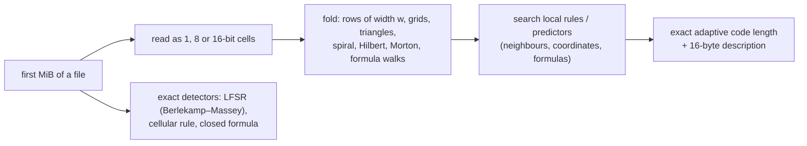

# Shape search: fold the bytes into a shape and look for a local rule

> **Verdict: finds every planted program; on real files only plain grids help.** Planted programs (an LFSR, rule
> 30, rule 110, an x XOR y image) are found and described in 24–287 bytes. On real files the only shapes that win
> are ordinary rasters and columns: the fax page (−25% vs xz, estimate) and a spreadsheet (−23%). Triangles,
> spirals, Hilbert and Morton orders and formula-defined walks never win. Text has no shape (+17% to +35% vs xz).
>
> Part of [chapter 3](../../report/3-reshaping.md) of the [report](../../report/README.md).

## Question

The project's starting intuition was that data might become simple once it is folded into the right shape:
rows of the right width, boxes inside boxes, triangles, a spiral walk. Does any such shape, plus a small local
rule ("this bit equals the one above XOR the one to the left"), describe real files?

## How it works



- [`shapesearch.py`](shapesearch.py) prices each shape + rule with a sequential adaptive bit model (exact code
  length, no archive written) and runs exact detectors for programs; [`planted.py`](planted.py) writes the
  planted controls.
- [`scan.c`](scan.c) is the exact stride scan: for every row width *w* it measures how predictable a byte is
  from the byte *w* positions earlier, which reveals record and image widths.
- [`shape_before_known.py`](shape_before_known.py) applies the found width as a reversible re-layout and then
  hands the bytes to ordinary compressors, which turns the estimate into real archives.

## Results

First MiB of each file. Shape-search sizes are **exact code lengths** (no decoder was written); every other
number is a real archive. Carried over from November 23, 2026; the rerun of this step is listed in
[`research/lab-reruns.sh`](../lab-reruns.sh) and [`lab-reruns-2.sh`](../lab-reruns-2.sh).

| File | xz -9e | Best of gzip/bzip2/zstd/brotli/xz | Shape search (estimate) | What it found |
|---|---:|---:|---:|---|
| planted LFSR | 1,048,688 | 1,048,584 | **32** | the linear rule (31 taps) |
| planted rule 30 | 327,976 | 324,941 | **31** | rule 30 on a 2,048-wide grid |
| planted rule 110 | 124,224 | 124,224 | **287** | rule 110 |
| planted x XOR y image | 1,988 | 1,988 | **24** | the formula x^y at width 1,024 |
| planted noisy circles | 251,100 | 251,100 | **50,037** | (x²+y²)>>6 per column |
| fax page (ptt5) | 39,860 | 39,860 | 29,745 | raster 1,729 bits wide, 4 neighbours |
| spreadsheet (kennedy.xls) | 51,868 | 51,868 | 39,925 | 13 columns, read column by column |
| x-ray image | 536,956 | 487,012 | 438,613 | 16-bit samples, pixel two to the left |
| MRI image (mr) | 264,592 | 229,405 | 221,969 | byte pairs, the row above |
| star catalogue (sao) | 650,276 | 650,276 | 639,923 | 14-byte records |
| text (alice29, dickens, enwik8) | 48,528 / 310,240 / 302,792 | | 53,676 / 363,634 / 407,245 | no shape: previous bytes only |
| office binary, database (ooffice, osdb) | 481,080 / 314,072 | | 562,763 / 397,494 | no shape |

The published cmix result on the whole fax page is 21,883 bytes and on kennedy.xls 7,955 bytes: the shapes found
here are real but far from the best models for these files.

**Shape first, then a known compressor** (real archives): kennedy.xls with each byte minus the byte 13 positions
earlier, then bzip2: 130,280 → 20,307 bytes. ptt5 read in columns of width 216, then PPMd: 48,581 → 30,537 bytes.

**Compress first, then look for a shape** fails: xz output of enwik8 is 7.9994 bits per byte and no shape or
tool shrinks it further (best −0.05%).

## Run it

```sh
make -C research lab
python3 research/stride-scan/planted.py runs/planted
CAP=1048576 python3 research/stride-scan/shapesearch.py runs/shapes.json runs/planted/* "$CORPUS"/canterbury/ptt5
research/build/stride-scan "$CORPUS/canterbury/ptt5" runs/ptt5.tsv 1-4096
CORPUS=$CORPUS python3 research/stride-scan/shape_before_known.py
```
