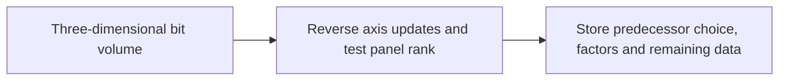
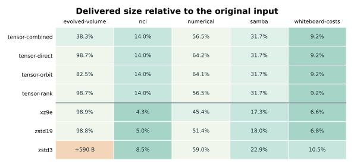

# Reversible 3D automata before GF(2) panel coding

[Method diagram](#method-diagram) · [Charts and benchmark tables](#large-file-benchmark)

## Question and prior work

A 3D automaton can spread local low-rank structure across planes. Can a decoder recover the original volume cheaply if the encoder stores an earlier state? The native kernel comes from `lab/hutter/divisors/q-correzioni-fattori/encoder-cofattori/cmix-neif-2.0/griglie-intere/automi/inverso/passi.cpp`. Historically it was applied to U, V and an XOR correction E derived from a Neif archive. Here it is paired with an exact panel coder on ordinary file bytes.

## Run the experiment

```sh
mkdir -p runs
python3 research/tensor-orbits/codec.py encode "$CORPUS/canterbury/ptt5" runs/fax.tgf --profile combined
python3 research/tensor-orbits/codec.py decode runs/fax.tgf runs/fax.bin
cmp "$CORPUS/canterbury/ptt5" runs/fax.bin
python3 research/tensor-orbits/benchmark.py "$CORPUS" runs/volumes
```

## Variants and format

Each full 8 KiB slab is a volume of 64 planes, each 16 rows by 64 bits. A step updates alternating parities along x, y and z in six half-steps with zero boundaries. A cell XORs either its preceding neighbor or the AND of its two neighbors along the axis. An individual half-step is its own inverse because its donors remain fixed. Applying the six half-steps in reverse order therefore gives a predecessor.

For each candidate state, the panel coder groups a plane into eight 16 × 8 binary matrices. Rank zero needs only a tag. Rank one or two carries basis rows and binary coordinates. Higher rank escapes to literal row bytes. Tags, bases, coordinates and literal panels form separate lanes. Direct, orbit-only, rank-only and combined profiles all use DEFLATE level 6 on the candidate payload. The four-byte slab record pays for method, rule, step and compressed length. All four share a 12-byte file header. A partial slab can enter the geometry search if it contains whole planes.

### Method diagram



**Mechanism and test.** Reverse evolution can restore low-rank planes when the source was mixed by the tested dynamics. Orbit-only and panel-only coding help distinguish simpler predecessor bytes from a genuine factorization gain.

## Inputs and measurement

The primary trial measures `tensor-combined` on the complete `evolved-volume` input (25,165,824 raw bytes). The runner invokes a separate decoder and compares the reconstructed file byte for byte. The earlier measurements below retain their original input sizes.

## Results

| Input | Direct | Orbit only | Rank only | Both | XZ extreme |
|---|---:|---:|---:|---:|---:|
| Evolved rank-two volume, 256 KiB | 259,175 | 216,650 | 259,157 | 100,339 | 258,752 |
| Full Canterbury fax | 56,191 | 56,186 | 56,032 | 56,027 | 39,860 |
| Silesia MR, first MiB | 377,578 | 377,578 | 299,013 | 298,966 | 264,592 |
| Silesia X-ray, first MiB | 788,099 | 787,711 | 627,116 | 627,116 | 536,956 |

The plant uses independent rank-two panel bases and then evolves each slab forward by a search-supported distance. The combined decoder recovers this construction. On MR almost all the gain came from the panel representation, with 47 additional bytes from the orbit search. The same extra step saved five bytes on the fax and zero on X-ray, uniform noise, the spreadsheet and the enwik8 prefix. [All comparisons](results/comparisons.csv) · [Rule and step selections](results/trials.csv)

## Large-file benchmark

On `evolved-volume` (25,165,824 raw bytes), `tensor-combined` produced 9,632,435 archive bytes. Zstandard level 3 used 25,166,414 bytes on the same input. [Input and timing](../large-scale/results/by-dataset.md#evolved-volume) · [All project measurements](../large-scale/results/by-experiment.md#tensor-orbits)

<!-- BEGIN generated project measurements -->

Each archive passed a byte-for-byte round trip. Bytes saved subtracts the archive and any required reference from the raw input size. Timings are seconds from one run.

On the primary input `evolved-volume`, `tensor-combined` delivers 9,632,435 bytes, 15,533,979 bytes smaller than standalone Zstandard 3 (25,166,414 bytes).

Holding `tensor-combined` fixed across the 5 measured input/reference settings with a standalone Zstandard 3 control gives **3 smaller, 0 equal and 2 larger** delivered archives. Each setting counts once.

### Archive comparison across inputs



Read down a column to compare methods on identical input. Lower is better. 100% is the raw file size. Where available, standard codecs appear below the dividing line. Near 100%, cells give the exact byte difference from raw (+ means larger). Below 0.1%, they give the exact delivered total. A dash means the combination was unmeasured.

This project's published large-file trials measure complete archives. The effect on gzip, Zstandard or XZ after an isolated preprocessing step is unmeasured here.

### evolved-volume · 25,165,824 raw bytes

**Standalone archives**

| Profile | Archive bytes | Bytes saved vs raw | Encode (s) | Decode (s) |
|---|---:|---:|---:|---:|
| `tensor-combined` | 9,632,435 | +15,533,389 | 49.090 | 4.947 |
| `tensor-direct` | 24,838,928 | +326,896 | 5.322 | 2.043 |
| `tensor-orbit` | 20,763,341 | +4,402,483 | 22.099 | 4.008 |
| `tensor-rank` | 24,837,235 | +328,589 | 9.457 | 1.485 |

Same-input baseline archives (bytes) · XZ 9 extreme 24,885,056 · Zstandard 19 24,870,519 · Zstandard 3 25,166,414

[Input hash and all measured codecs](../large-scale/results/by-dataset.md#evolved-volume)

### nci · 33,553,445 raw bytes

**Standalone archives**

| Profile | Archive bytes | Bytes saved vs raw | Encode (s) | Decode (s) |
|---|---:|---:|---:|---:|
| `tensor-combined` | 4,690,214 | +28,863,231 | 24.318 | 0.402 |
| `tensor-direct` | 4,690,214 | +28,863,231 | 0.698 | 0.512 |
| `tensor-orbit` | 4,690,214 | +28,863,231 | 10.560 | 0.486 |
| `tensor-rank` | 4,690,214 | +28,863,231 | 2.219 | 0.493 |

Same-input baseline archives (bytes) · XZ 9 extreme 1,449,272 · Zstandard 19 1,664,988 · Zstandard 3 2,835,400

[Input hash and all measured codecs](../large-scale/results/by-dataset.md#nci)

### numerical · 25,696,748 raw bytes

**Standalone archives**

| Profile | Archive bytes | Bytes saved vs raw | Encode (s) | Decode (s) |
|---|---:|---:|---:|---:|
| `tensor-combined` | 14,514,489 | +11,182,259 | 17.698 | 0.821 |
| `tensor-direct` | 16,487,419 | +9,209,329 | 0.577 | 0.303 |
| `tensor-orbit` | 16,483,488 | +9,213,260 | 3.303 | 0.451 |
| `tensor-rank` | 14,514,642 | +11,182,106 | 1.429 | 0.517 |

Same-input baseline archives (bytes) · XZ 9 extreme 11,662,476 · Zstandard 19 13,213,336 · Zstandard 3 15,163,683

[Input hash and all measured codecs](../large-scale/results/by-dataset.md#numerical)

### samba · 21,606,400 raw bytes

**Standalone archives**

| Profile | Archive bytes | Bytes saved vs raw | Encode (s) | Decode (s) |
|---|---:|---:|---:|---:|
| `tensor-combined` | 6,853,237 | +14,753,163 | 13.090 | 0.369 |
| `tensor-direct` | 6,853,254 | +14,753,146 | 0.713 | 0.298 |
| `tensor-orbit` | 6,853,252 | +14,753,148 | 5.074 | 0.407 |
| `tensor-rank` | 6,853,239 | +14,753,161 | 1.624 | 0.394 |

Same-input baseline archives (bytes) · XZ 9 extreme 3,739,524 · Zstandard 19 3,894,675 · Zstandard 3 4,957,768

[Input hash and all measured codecs](../large-scale/results/by-dataset.md#samba)

### whiteboard-costs · 33,554,432 raw bytes

**Standalone archives**

| Profile | Archive bytes | Bytes saved vs raw | Encode (s) | Decode (s) | Peak KiB (encode / decode) |
|---|---:|---:|---:|---:|---:|
| `tensor-combined` | 3,090,273 | +30,464,159 | 80.379 | 1.449 | 74,000 / 103,500 |
| `tensor-direct` | 3,090,273 | +30,464,159 | 5.638 | 1.369 | 73,180 / 102,788 |
| `tensor-orbit` | 3,090,273 | +30,464,159 | 32.159 | 2.256 | 72,812 / 103,824 |
| `tensor-rank` | 3,090,273 | +30,464,159 | 10.319 | 0.757 | 73,968 / 103,500 |

Same-input baseline archives (bytes) · XZ 9 extreme 2,203,672 · Zstandard 19 2,286,184 · Zstandard 3 3,513,689

[Input hash and all measured codecs](../large-scale/results/by-dataset.md#whiteboard-costs)

### Reproduce the large-file comparison

From the repository root, with the pinned inputs and project dependencies installed, replay all published standalone profiles for this folder into a fresh directory.

```sh
python3 research/large-scale/primary.py runs/replay-tensor-orbits --project tensor-orbits --all-profiles
```

[Dataset preparation](../large-scale/README.md#inputs) · [Archive hashes and settings](../large-scale/results/archives.jsonl)

<!-- END generated project measurements -->

## Connections

[Four-dimensional automata with noisy binary matrix factors](../four-dimensional-factors/README.md) · [Byte-valued cellular automata and Kronecker factors](../modular-kronecker/README.md)
