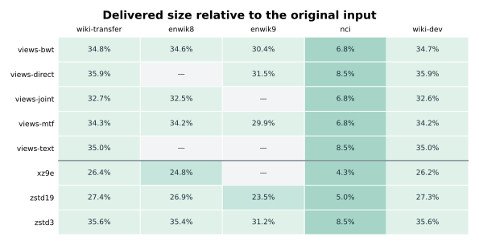
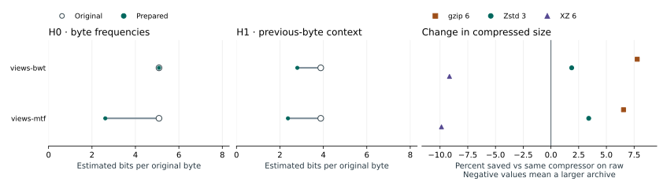

# Text fields, BWT and move-to-front

> **Verdict: loses on real data.** Best real input: Wikipedia text, another 24 MiB, +24.0% vs xz -9e.
>
> Part of [chapter 3](../../report/3-reshaping.md) of the [report](../../report/README.md). Terms: [glossary](../../report/glossary.md).

## Question

Does normalising spelling and XML fields before the Burrows–Wheeler transform make Wikipedia text easier to compress?

## How it works


Reversible views (capital flags, field normalisation, BWT, move-to-front) are applied and the result is compressed by a standard back end.

<details><summary>Technical details</summary>

Can normalization of spelling and XML fields make Burrows–Wheeler sorting more useful on a new slice of text?

**Mechanism and test.** BWT preserves symbol multiplicities in its payload while changing their order. That changes matches and contexts available to the backend. The same Wikipedia transformation helps gzip and Zstandard while increasing the XZ output.

The front end can fold capitals, code frequent words, split XML bodies and store header fields by column. A dictionary and unused markers travel with each selected transformed block. The encoder checks the invertibility of a text candidate before offering it. BWT stores a primary index; move-to-front needs no extra dictionary beyond its initial byte alphabet. Direct and transformed outputs all use Zstandard 3, with literal fallback.

</details>

## Results on 20 MiB inputs

Every archive below decoded byte-exact. *Our archive* is this project's own format. *Our transform → standard tool* reshapes the bytes reversibly and hands the result to gzip, zstd or xz; it is listed only where it beats that same tool on the raw bytes. *Best standard tool* is the smallest of gzip, bzip2, xz, Zstandard, Brotli and PPMd (plus domain codecs for images, scans and video) on the raw bytes. *Difference* compares the better of our two columns with it; negative = ours is smaller.

| Input | Kind | Raw bytes | Our archive | Our transform → standard tool | Best standard tool | Difference |
|---|---|---:|---:|---:|---:|---:|
| Wikipedia text, enwik8 (100 MB) | real | 100,000,000 | 32,539,733 (`views-joint`) | — | 24,831,648 (xz -9e) | +31.0% |
| Silesia nci (chemical database) | real | 33,553,445 | 2,280,295 (`views-joint`) | — | 1,449,272 (xz -9e) | +57.3% |
| Wikipedia text, 24 MiB | real | 25,165,824 | 8,214,112 (`views-joint`) | — | 6,602,488 (xz -9e) | +24.4% |
| Wikipedia text, another 24 MiB | real | 25,165,824 | 8,231,816 (`views-joint`) | 8,513,896 (`views-bwt → gzip-6`) | 6,637,336 (xz -9e) | +24.0% |
| enwik9 | other | 1,000,000,000 | 299,270,871 (`views-mtf`) | — | 235,328,939 (zstd -19) | +27.2% |

<details><summary>All profiles, timings and entropy measurements</summary>

<!-- BEGIN generated project measurements -->

Each archive passed a byte-for-byte round trip. *Bytes saved* is raw size minus archive (and any reference the decoder needs). Timings are one run on a shared desktop.

These tables list every measured profile. The comparison with the best standard tool on each input (gzip, bzip2, xz, Zstandard, Brotli, PPMd and the domain codecs) is the Results table above.

### Archive comparison across inputs



Read down a column to compare methods on identical input. Lower is better. 100% is the raw file size. Where available, standard codecs appear below the dividing line. Near 100%, cells give the exact byte difference from raw (+ means larger). Below 0.1%, they give the exact delivered total. A dash means the combination was unmeasured.

The paired figures below measure preprocessing separately. H0 measures byte frequencies. H1 conditions on the previous byte. The tables give both in bits per byte of their own stream. The figures express model costs per original byte. H0 counts every byte. H1 counts each adjacent pair, omitting the first byte’s marginal cost. Positive compressor savings mean a smaller compressed file.

### wiki-transfer · 25,165,824 raw bytes



Of 2 measured profiles on this input, 2 reduced gzip size, 2 reduced Zstandard size and 0 reduced XZ size. Exact ties count separately from improvements.

**Entropy before and after preprocessing**

| Profile | Prepared bytes | H0 before → after | H1 before → after | Post H0 per raw byte |
|---|---:|---:|---:|---:|
| `views-bwt` | 25,165,956 | 5.0850 → 5.0851 | 3.8807 → 2.8011 | 5.0851 |
| `views-mtf` | 25,165,956 | 5.0850 → 2.6119 | 3.8807 → 2.3702 | 2.6119 |

**Same compressor on original → prepared bytes**

| Profile | gzip 6 | Zstandard 3 | XZ 6 |
|---|---:|---:|---:|
| `views-bwt` | 9,232,082 → 8,513,896 (+7.78%) | 8,968,455 → 8,800,771 (+1.87%) | 6,743,812 → 7,360,740 (-9.15%) |
| `views-mtf` | 9,232,082 → 8,627,926 (+6.54%) | 8,968,455 → 8,662,902 (+3.41%) | 6,743,812 → 7,409,368 (-9.87%) |

**Standalone archives**

| Profile | Archive bytes | Bytes saved vs raw | Encode (s) | Decode (s) |
|---|---:|---:|---:|---:|
| `views-bwt` | 8,759,477 | +16,406,347 | 3.986 | 1.809 |
| `views-direct` | 9,032,653 | +16,133,171 | 1.529 | 1.393 |
| `views-joint` | 8,231,816 | +16,934,008 | 220.832 | 15.136 |
| `views-mtf` | 8,637,232 | +16,528,592 | 6.124 | 2.520 |
| `views-text` | 8,804,216 | +16,361,608 | 158.612 | 14.020 |

Same-input baseline archives (bytes) · XZ 9 extreme 6,637,336 · Zstandard 19 6,891,038 · Zstandard 3 8,968,456

[Input hash and all measured codecs](../large-scale/results/by-dataset.md#wiki-transfer)

### enwik8 · 100,000,000 raw bytes

**Standalone archives**

| Profile | Archive bytes | Bytes saved vs raw | Encode (s) | Decode (s) |
|---|---:|---:|---:|---:|
| `views-bwt` | 34,640,737 | +65,359,263 | 12.266 | 3.740 |
| `views-joint` | 32,539,733 | +67,460,267 | 427.914 | 27.341 |
| `views-mtf` | 34,159,835 | +65,840,165 | 16.425 | 4.802 |

Same-input baseline archives (bytes) · XZ 9 extreme 24,831,648 · Zstandard 19 26,944,227 · Zstandard 3 35,445,335

[Input hash and all measured codecs](../large-scale/results/by-dataset.md#enwik8)

### enwik9 · 1,000,000,000 raw bytes

**Standalone archives**

| Profile | Archive bytes | Bytes saved vs raw | Encode (s) | Decode (s) |
|---|---:|---:|---:|---:|
| `views-bwt` | 303,703,378 | +696,296,622 | 188.514 | 71.211 |
| `views-direct` | 314,928,681 | +685,071,319 | 63.886 | 21.820 |
| `views-mtf` | 299,270,871 | +700,729,129 | 152.272 | 69.987 |

Same-input baseline archives (bytes) · Zstandard 19 235,328,939 · Zstandard 3 312,109,709

[Input hash and all measured codecs](../large-scale/results/by-dataset.md#enwik9)

### nci · 33,553,445 raw bytes

**Standalone archives**

| Profile | Archive bytes | Bytes saved vs raw | Encode (s) | Decode (s) |
|---|---:|---:|---:|---:|
| `views-bwt` | 2,280,687 | +31,272,758 | 5.173 | 2.580 |
| `views-direct` | 2,864,760 | +30,688,685 | 0.831 | 0.981 |
| `views-joint` | 2,280,295 | +31,273,150 | 70.941 | 3.429 |
| `views-mtf` | 2,280,687 | +31,272,758 | 8.153 | 2.806 |
| `views-text` | 2,855,044 | +30,698,401 | 55.996 | 2.158 |

Same-input baseline archives (bytes) · XZ 9 extreme 1,449,272 · Zstandard 19 1,664,988 · Zstandard 3 2,835,400

[Input hash and all measured codecs](../large-scale/results/by-dataset.md#nci)

### wiki-dev · 25,165,824 raw bytes

**Standalone archives**

| Profile | Archive bytes | Bytes saved vs raw | Encode (s) | Decode (s) |
|---|---:|---:|---:|---:|
| `views-bwt` | 8,728,653 | +16,437,171 | 3.093 | 1.817 |
| `views-direct` | 9,022,572 | +16,143,252 | 1.520 | 0.670 |
| `views-joint` | 8,214,112 | +16,951,712 | 188.117 | 23.217 |
| `views-mtf` | 8,613,021 | +16,552,803 | 5.837 | 2.099 |
| `views-text` | 8,795,530 | +16,370,294 | 111.136 | 11.170 |

Same-input baseline archives (bytes) · XZ 9 extreme 6,602,488 · Zstandard 19 6,873,848 · Zstandard 3 8,951,574

[Input hash and all measured codecs](../large-scale/results/by-dataset.md#wiki-dev)

### Reproduce the large-file comparison

From the repository root, with the pinned inputs and project dependencies installed, replay all published standalone profiles for this folder into a fresh directory.

```sh
python3 research/large-scale/primary.py runs/replay-text-views --project text-views --all-profiles
```

[Dataset preparation](../large-scale/README.md#inputs) · [Archive hashes and settings](../large-scale/results/archives.jsonl)

A separate paired run also records entropy, stream hashes and the three backend sizes.

```sh
mkdir -p runs/paired
python3 research/large-scale/entropy_bench.py views-bwt runs/large/raw/wiki-transfer runs/paired/text-views.json
```

[All paired stream hashes and compressor versions](../large-scale/results/preprocessing.jsonl)

<!-- END generated project measurements -->

</details>

## Small-scale results

Two nonoverlapping 24 MiB windows start at byte zero and byte 67,108,864 of enwik8. Separate runs use the full Silesia NCI file and the complete Wikipedia corpora for the profiles tabulated there.

On wiki-dev the best text-only archive used 8,795,530 bytes, BWT plus move-to-front used 8,613,021 and the joint archive 8,214,112. On wiki-transfer those figures were 8,804,216, 8,637,232 and 8,231,816. Whole-file XZ extreme still produced 6,637,336 on transfer. [Full archive sizes, times and hashes](../large-scale/results/by-dataset.md)

## Run it

Run these commands from the repository root. The [large-suite instructions](../large-scale/README.md) give input preparation, dependencies and the complete benchmark command.

```sh
mkdir -p runs
python3 research/text-views/codec.py encode runs/large/raw/wiki-transfer runs/wiki.tvw --profile joint
python3 research/text-views/codec.py decode runs/wiki.tvw runs/wiki.restored
cmp runs/large/raw/wiki-transfer runs/wiki.restored
```

## Provenance

<details><summary>Where this code came from</summary>

The text front end is ported from `lab/textfront/textfront.py`. BWT uses the retained libsais source and the move-to-front operation follows `lab/arena/view.cpp`. The new TVW1 format records the selected front end and backend for each 2 MiB block.

</details>
