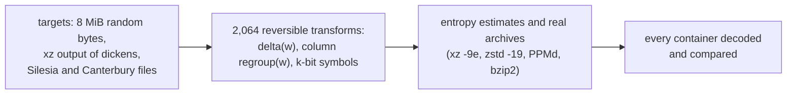

# Transform controls: what reshaping can and cannot do

> **Verdict: controls.** On random bytes and on already-compressed data no reshape helps; the price of a
> permutation always eats what sorting saves; re-reading bits in a different symbol size makes normal files
> larger. When data really is hidden inside a bigger alphabet (hex, base64, UTF-16), undoing it is found and
> saves 1–31%.
>
> Part of [chapter 3](../../report/3-reshaping.md) of the [report](../../report/README.md).

## Question

Every reshaping result in this repository needs a control: what does the same search do on data that has
**no** structure left? And what do changes of alphabet do to ordinary files?

## How it works



- [`part1_search.py`](part1_search.py): 1,024 delta widths, 1,024 column regroupings and 16 bit-symbol sizes on
  8 MiB of seeded random bytes and on `xz -9e` output of Silesia *dickens*; each candidate is priced by
  entropy estimates and by real xz and zstd archives with a 2-byte header.
- [`part2_perm.py`](part2_perm.py): sort the bytes of *dickens* (very compressible) and add the exact cost of
  naming the permutation, log₂(n! / ∏ count!).
- [`alphabet/`](alphabet): re-read a file's bits as k-bit symbols (k = 1…24), undo hidden alphabets (hex, base64,
  UTF-16 versions of enwik8), relabel byte values (control).

## Results

<!-- TC-RERUN -->

**Alphabets** (carried over from November 18, 2026; [raw rows](alphabet/results-2026-11-18)). Ratio = archive
with the transform (header included) ÷ archive without it, same back end.

| Experiment | Rows | Best | Median | Worst |
|---|---:|---:|---:|---:|
| Re-read bits as k-bit symbols (Silesia, Canterbury, random) | 30 | 0.973¹ | 1.037 | 1.221 |
| Undo a hidden alphabet (enwik8 as hex, base64, UTF-16) | 4 | **0.692** | 0.856 | 1.005 |
| Relabel the 256 byte values (control) | 2 | 0.995 | 1.005 | 1.043 |

¹ PPMd order 16 on *dickens*, whose own result without the transform was unusually poor; with order 8 the gain
disappears.

## Run it

```sh
python3 research/transform-controls/part1_search.py --dickens "$CORPUS/silesia/dickens" --work runs/tc --outdir runs/tc
python3 research/transform-controls/part2_perm.py --file "$CORPUS/silesia/dickens" --work runs/tc --out runs/tc/part2.json
```
