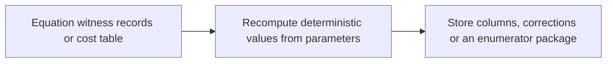
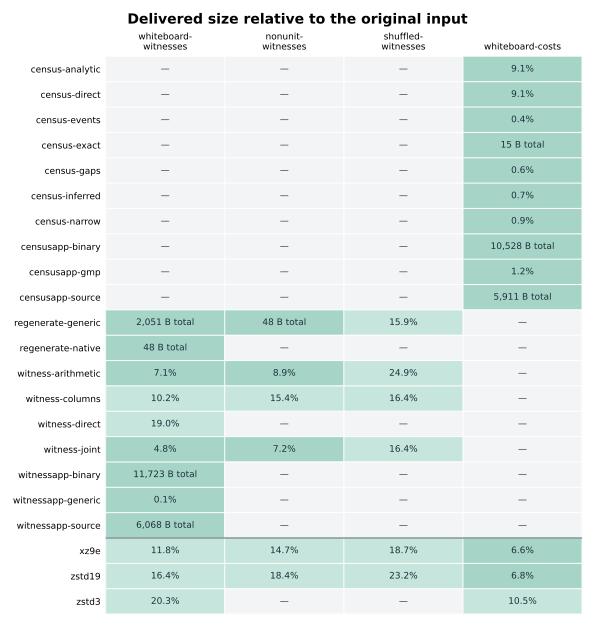
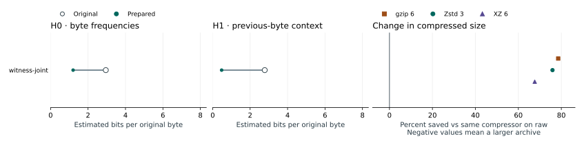
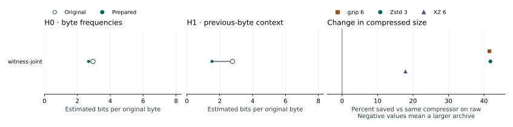

# The whiteboard census and its formula witnesses

> **Verdict: self-generated data only.** The input is the output of our own program.
>
> Counting every number below 2²⁸ under a decodable price: 974 of 268 million get any shorter description and none by 16 bits ([counts](counts)).
>
> Part of [chapter 1](../../report/1-formulas.md) of the [report](../../report/README.md). Terms: [glossary](../../report/glossary.md).

## Question

How many numbers does the whiteboard formula actually shorten, and can its tables be rebuilt from the formula?

## How it works



An exhaustive enumerator computes, for every number below 2ᴺ, the cheapest repdigit or repdigit ratio. Its tables and witness records are then compressed by recomputation, by columns, or both.

<details><summary>Technical details</summary>

The 2019 board proposed the ratio of two repeated-digit integers. How many values actually have a cheap representation, and do those same equations help compress the research outputs? This project restores `lab/whiteboard/rep_fast.c`, the independent Python brute-force checker and the original analysis of every recorded saving witness. The census tables, witness archives and ordinary raw files are three different targets.

**Mechanism and test.** Correctly paired parameters and values make recomputation possible. Permuting value/cost pairs preserves the column values but breaks the equations. On that control the joint selector falls back to the columns result.

For each positive integer below 2ᴺ, F3 records the minimum sum of the bit lengths of a digit, base and exponent. F6 records the analogous minimum for a ratio of two such triples, subject to a total budget K. A value of 255 marks a missing admissible ratio. The native enumerator prunes impossible magnitude pairs and tests surviving divisions using exact 64-bit or GMP arithmetic. The checker independently builds small cases with Python integers. The historical N=24 run found 142,040 apparent savers at the sum-of-bit-lengths price. Only 171 survived its separately specified gamma price. [Historical source map](../evidence/idea-atlas.md)

WCT1 compares general compression with a one-digit prediction, a lower-budget census plus XOR residuals, and a full matching census. WFW1 reads the original packed little-endian witness records. It can separate their fields, or evaluate the numerator and denominator from three or six parameters and predict the integer and its bit-length cost. The combined version also prices column differences, stores any arithmetic mismatch exactly and removes the predictable base offset when an exponent is one.

</details>

## Results on 20 MiB inputs

Every archive below decoded byte-exact. *Our archive* is this project's own format. *Our transform → standard tool* reshapes the bytes reversibly and hands the result to gzip, zstd or xz; it is listed only where it beats that same tool on the raw bytes. *Best standard tool* is the smallest of gzip, bzip2, xz, Zstandard, Brotli and PPMd (plus domain codecs for images, scans and video) on the raw bytes. *Difference* compares the better of our two columns with it; negative = ours is smaller.

| Input | Kind | Raw bytes | Our archive | Our transform → standard tool | Best standard tool | Difference |
|---|---|---:|---:|---:|---:|---:|
| New witness records printed by our enumerator | self-generated | 32,870,784 | 48 (`regenerate-generic`) | — | 4,844,832 (xz -9e) | **100,934× smaller** |
| Census tables printed by our enumerator | self-generated | 33,554,432 | 15 (`census-exact`) | — | 2,203,672 (xz -9e) | **146,911× smaller** |
| Witness records printed by our enumerator | self-generated | 22,630,320 | 48 (`regenerate-native`) | 961,108 (`witness-joint → xz-6`) | 2,679,352 (xz -9e) | **55,820× smaller** |
| Witness records with values shuffled | control | 22,630,320 | 3,589,802 (`regenerate-generic`) | 3,550,292 (`witness-joint → xz-6`) | 4,237,984 (xz -9e) | **−16.2%** |

<details><summary>All profiles, timings and entropy measurements</summary>

<!-- BEGIN generated project measurements -->

Each archive passed a byte-for-byte round trip. *Bytes saved* is raw size minus archive (and any reference the decoder needs). Timings are one run on a shared desktop.

These tables list every measured profile. The comparison with the best standard tool on each input (gzip, bzip2, xz, Zstandard, Brotli, PPMd and the domain codecs) is the Results table above.

### Archive comparison across inputs



Read down a column to compare methods on identical input. Lower is better. 100% is the raw file size. Where available, standard codecs appear below the dividing line. Near 100%, cells give the exact byte difference from raw (+ means larger). Below 0.1%, they give the exact delivered total. A dash means the combination was unmeasured.

The paired figures below measure preprocessing separately. H0 measures byte frequencies. H1 conditions on the previous byte. The tables give both in bits per byte of their own stream. The figures express model costs per original byte. H0 counts every byte. H1 counts each adjacent pair, omitting the first byte’s marginal cost. Positive compressor savings mean a smaller compressed file.

### whiteboard-witnesses · 22,630,320 raw bytes



Of 1 measured profiles on this input, 1 reduced gzip size, 1 reduced Zstandard size and 1 reduced XZ size. Exact ties count separately from improvements.

**Entropy before and after preprocessing**

| Profile | Prepared bytes | H0 before → after | H1 before → after | Post H0 per raw byte |
|---|---:|---:|---:|---:|
| `witness-joint` | 14,110,128 | 2.9495 → 1.9285 | 2.7803 → 0.7663 | 1.2024 |

**Same compressor on original → prepared bytes**

| Profile | gzip 6 | Zstandard 3 | XZ 6 |
|---|---:|---:|---:|
| `witness-joint` | 5,230,942 → 1,122,203 (+78.55%) | 4,602,354 → 1,109,554 (+75.89%) | 2,968,412 → 961,108 (+67.62%) |

**Standalone archives**

| Profile | Archive bytes | Bytes saved vs raw | Encode (s) | Decode (s) | Peak KiB (encode / decode) |
|---|---:|---:|---:|---:|---:|
| `regenerate-generic` | 2,051 | +22,628,269 | 34.105 | 35.762 | 295,012 / 295,028 |
| `regenerate-native` | 48 | +22,630,272 | 40.396 | 38.186 | 292,572 / 291,152 |
| `witness-arithmetic` | 1,600,689 | +21,029,631 | 15.036 | 17.481 | 186,820 / 174,656 |
| `witness-columns` | 2,306,827 | +20,323,493 | 6.560 | 1.381 | 115,028 / 126,816 |
| `witness-direct` | 4,289,180 | +18,341,140 | 3.847 | 1.603 | 79,900 / 68,780 |
| `witness-joint` | 1,082,142 | +21,548,178 | 37.870 | 22.854 | 240,440 / 175,904 |
| `witnessapp-binary` | 11,723 | +22,618,597 | 42.400 | 42.596 | 291,148 / 293,172 |
| `witnessapp-generic` | 29,100 | +22,601,220 | 32.989 | 58.207 | 292,520 / 293,296 |
| `witnessapp-source` | 6,068 | +22,624,252 | 38.704 | 42.680 | 292,288 / 291,504 |

Same-input baseline archives (bytes) · XZ 9 extreme 2,679,352 · Zstandard 19 3,705,005 · Zstandard 3 4,602,358

[Input hash and all measured codecs](../large-scale/results/by-dataset.md#whiteboard-witnesses)

### nonunit-witnesses · 32,870,784 raw bytes

**Standalone archives**

| Profile | Archive bytes | Bytes saved vs raw | Encode (s) | Decode (s) | Peak KiB (encode / decode) |
|---|---:|---:|---:|---:|---:|
| `regenerate-generic` | 48 | +32,870,736 | 188.251 | 158.402 | 1,173,904 / 1,176,124 |
| `witness-arithmetic` | 2,937,903 | +29,932,881 | 32.149 | 13.398 | 272,156 / 246,956 |
| `witness-columns` | 5,053,332 | +27,817,452 | 8.455 | 1.801 | 148,572 / 176,972 |
| `witness-joint` | 2,378,373 | +30,492,411 | 32.827 | 10.948 | 375,300 / 246,108 |

Same-input baseline archives (bytes) · XZ 9 extreme 4,844,832 · Zstandard 19 6,038,280

[Input hash and all measured codecs](../large-scale/results/by-dataset.md#nonunit-witnesses)

### shuffled-witnesses · 22,630,320 raw bytes



Of 1 measured profiles on this input, 1 reduced gzip size, 1 reduced Zstandard size and 1 reduced XZ size. Exact ties count separately from improvements.

**Entropy before and after preprocessing**

| Profile | Prepared bytes | H0 before → after | H1 before → after | Post H0 per raw byte |
|---|---:|---:|---:|---:|
| `witness-joint` | 19,790,312 | 2.9495 → 3.0670 | 2.7803 → 1.7457 | 2.6821 |

**Same compressor on original → prepared bytes**

| Profile | gzip 6 | Zstandard 3 | XZ 6 |
|---|---:|---:|---:|
| `witness-joint` | 6,460,681 → 3,776,913 (+41.54%) | 6,474,999 → 3,768,334 (+41.80%) | 4,322,840 → 3,550,292 (+17.87%) |

**Standalone archives**

| Profile | Archive bytes | Bytes saved vs raw | Encode (s) | Decode (s) | Peak KiB (encode / decode) |
|---|---:|---:|---:|---:|---:|
| `regenerate-generic` | 3,589,802 | +19,040,518 | 42.129 | 35.358 | 293,360 / 291,324 |
| `witness-arithmetic` | 5,638,203 | +16,992,117 | 20.188 | 28.897 | 188,912 / 180,288 |
| `witness-columns` | 3,721,398 | +18,908,922 | 7.354 | 2.066 | 109,284 / 127,272 |
| `witness-joint` | 3,721,398 | +18,908,922 | 54.704 | 2.733 | 244,156 / 129,616 |

Same-input baseline archives (bytes) · XZ 9 extreme 4,237,984 · Zstandard 19 5,252,719

[Input hash and all measured codecs](../large-scale/results/by-dataset.md#shuffled-witnesses)

### whiteboard-costs · 33,554,432 raw bytes

**Standalone archives**

| Profile | Archive bytes | Bytes saved vs raw | Encode (s) | Decode (s) | Peak KiB (encode / decode) |
|---|---:|---:|---:|---:|---:|
| `census-analytic` | 3,039,880 | +30,514,552 | 8.050 | 1.622 | 182,528 / 172,540 |
| `census-direct` | 3,041,773 | +30,512,659 | 4.873 | 1.431 | 85,704 / 71,964 |
| `census-events` | 137,209 | +33,417,223 | 14.664 | 5.518 | 302,124 / 184,308 |
| `census-exact` | 15 | +33,554,417 | 17.654 | 9.498 | 185,616 / 100,428 |
| `census-gaps` | 187,296 | +33,367,136 | 8.398 | 5.284 | 187,004 / 185,544 |
| `census-inferred` | 246,627 | +33,307,805 | 14.704 | 7.610 | 230,924 / 183,636 |
| `census-narrow` | 316,324 | +33,238,108 | 14.485 | 5.187 | 184,260 / 167,012 |
| `censusapp-binary` | 10,528 | +33,543,904 | 24.969 | 13.651 | 183,260 / 81,140 |
| `censusapp-gmp` | 387,915 | +33,166,517 | 43.774 | 13.075 | 183,392 / 81,308 |
| `censusapp-source` | 5,911 | +33,548,521 | 20.335 | 16.818 | 181,280 / 81,188 |

Same-input baseline archives (bytes) · XZ 9 extreme 2,203,672 · Zstandard 19 2,286,184 · Zstandard 3 3,513,689

[Input hash and all measured codecs](../large-scale/results/by-dataset.md#whiteboard-costs)

### Reproduce the large-file comparison

From the repository root, with the pinned inputs and project dependencies installed, replay all published standalone profiles for this folder into a fresh directory.

```sh
python3 research/large-scale/primary.py runs/replay-whiteboard-census --project whiteboard-census --all-profiles
```

[Dataset preparation](../large-scale/README.md#inputs) · [Archive hashes and settings](../large-scale/results/archives.jsonl)

A separate paired run also records entropy, stream hashes and the three backend sizes.

```sh
mkdir -p runs/paired
python3 research/large-scale/entropy_bench.py witness-joint runs/large/raw/whiteboard-witnesses runs/paired/whiteboard-census.json
```

[All paired stream hashes and compressor versions](../large-scale/results/preprocessing.jsonl)

<!-- END generated project measurements -->

</details>

## Small-scale results

The **33,554,432-byte** cost target is the concatenation of the retained N=24 F3 and F6 files. The **22,630,320-byte** witness target contains two counts and the original N=26 record streams, including every value, parameter, cost and record position. The shuffled control keeps the same parameters and permutes complete value/cost pairs. Every decoder reconstructs the complete target. [Source member hashes](../large-scale/whiteboard.json)

| Witness representation | Archive bytes |
|---|---:|
| Direct Zstandard with framing | 4,289,180 |
| Separated columns | 2,306,827 |
| Recompute values and costs | 1,600,689 |
| Recompute and code columns | **1,082,142** |

Shuffling value/cost pairs among records reversed the result. Arithmetic alone grew to 5,638,203 bytes, and the joint selector chose the 3,721,398-byte column archive. On the unshuffled records, whole-file XZ extreme used 2,679,352 bytes.

For the cost table, running the census with K=21 and transmitting corrections took 316,324 bytes. K=23 recreated the measured table with a **15-byte descriptor and a shared enumerator**. The package containing both the enumerator's C source and its extraction code used **5,911 bytes**. The source package needs a C compiler and GMP development files. The binary package used 10,528 bytes and requires a compatible Linux ABI and installed GMP. The 387,915-byte variant also delivers GMP. [Complete archive and delivery comparisons](../large-scale/results/by-dataset.md#whiteboard-costs)

The new N=28, K=27 census found 1,515,430 six-parameter records. Filtering on the actual denominator retained 913,077 records whose denominator exceeds one, totaling **32,870,784 raw bytes** with framing. Columns alone cost 5,053,332 bytes, recomputing the arithmetic cost 2,937,903, and combining them cost **2,378,373**. Zstandard level 19 used 6,038,280 bytes. These records come from a separate enumeration of a wider range, which can include values already present in N=26. [Generator and member digests](../large-scale/nonunit.json)

The reduced-budget predictor also benefits from the equation itself. A denominator equal to one costs four parameter bits, so an admissible F3 representation implies an F6 upper bound. Applying that bound reduced the K=21 residual archive from 316,324 to 246,627 bytes. Grouping corrections by byte value and Rice-coding gaps between their positions cost 187,296 bytes on its own. Combining that coding with the arithmetic bound cost **137,209 bytes**, saving 50,087 bytes over the better individual change. All four configurations recover the same original 33,554,432 bytes.

An independent exhaustive Python check agreed on all 4,095 positive integers for N=12, K=14. On this host the generic and CPU-optimized C builds reproduced both historical N=24 cost tables. Several parameter tuples can tie at the same cost. The generic build reproduced the original F3 witness files while the original CPU-native build also reproduced both historical F6 witness files byte for byte at N=24 and N=26. [Exact build comparisons](compatibility.json)

### Shipping the witness computation

A further comparison regenerates the **sequence of records**, including their original order. WRT1 infers the bit width, budget and denominator filter, runs the same enumerator, and stores a SHA-256 digest of its prediction. It also sends the exact remaining differences. On the original N=26 witnesses, the generic build differed at 739 byte positions and used a **2,051-byte archive**. On this host the CPU-native build matched every position and used **48 bytes** with that enumerator installed. Shuffling the values and costs increased the generic archive to 3,589,802 bytes. The newly generated N=28 non-unit subset also regenerated from a 48-byte descriptor with its matching generic enumerator.

WRP1 delivers a Python extractor and the enumerator inside the archive. The source package used **6,068 bytes** including the 48-byte model and decoded the historical 22,630,320-byte stream in 42.7 seconds in this run. It requires Python, a compatible C compiler and GMP headers. The package carrying the CPU-native executable used 11,723 bytes and requires a compatible CPU, Linux ABI and GMP runtime. The generic source package with a DEFLATE correction cost 29,100 bytes. Each extractor checks the predicted sequence before applying corrections. These savings exploit a known computation that generated the target. [Complete delivery and timing receipts](../large-scale/results/by-dataset.md#whiteboard-witnesses)

## Run it

```sh
make -C research
mkdir -p runs/census
research/build/whiteboard-census 12 14 runs/census/small > runs/census/small.json
python3 research/whiteboard-census/brute_check.py 12 14 runs/census/small.f6.u8 runs/census/small.f3.u8 runs/census/check.json r1closed
python3 research/whiteboard-census/data.py .. runs/large/raw
python3 research/whiteboard-census/genuine.py runs/large/raw/nonunit-witnesses
python3 research/large-scale/replay.py whiteboard-witnesses runs/replay-witness witness-joint
python3 research/large-scale/replay.py whiteboard-costs runs/replay-census census-exact censusapp-source
```
