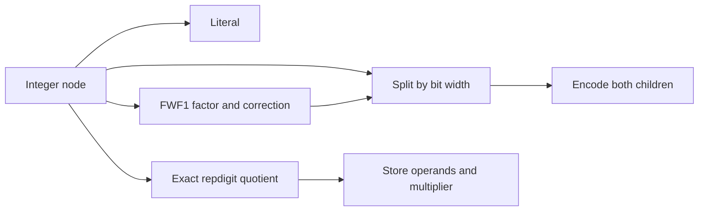
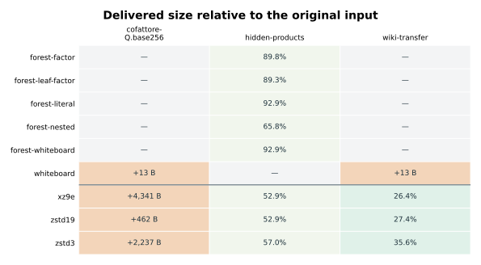

# Whiteboard quotients inside factor trees

> **Verdict: no meaningful gain on real data.** Best real input: Q: the record archive as an integer, −0.0005% vs zstd -19. Planted control: Products hiding a repdigit factor, +25.3% vs brotli -11.
>
> Part of [chapter 1](../../report/1-formulas.md) of the [report](../../report/README.md). Terms: [glossary](../../report/glossary.md).

## Question

Can the whiteboard formula (one repeated-digit number divided by another) describe nodes inside a factor tree, even if it cannot describe a whole file?

## How it works



At each tree node the encoder looks for a scaled quotient of two repdigits; if none fits it splits the cofactor again.

<details><summary>Technical details</summary>

The [original whiteboard](whiteboard.png) represents an integer as an exact ratio of repeated-digit numbers in different bases.

$$
\frac{\displaystyle\sum_{k=0}^{r_1-1} c_1 b_1^k}
     {\displaystyle\sum_{k=0}^{r_2-1} c_2 b_2^k}
=
\frac{c_1}{c_2}
\cdot \frac{b_1^{r_1}-1}{b_1-1}
\cdot \frac{b_2-1}{b_2^{r_2}-1}
= d.
$$

In the board notation $d$ is the result. The [QBT1 decoder](tree.py#L59-L73) calls the denominator base `d` and stores seven fields `(p, b, r, c, d, t, e)`. With `G(b,r,c)` denoting `r` copies of digit `c` in base `b`, its leaf value is `p × (G(b,r,c) / G(d,t,e))`. The decoder checks that the remainder is zero before multiplying by `p`. A missing denominator means one. A second experiment asks whether extracting a factor before choosing the next split can expose a quotient that a split of the original integer misses.

The QBT1 encoder and decoder come from `lab/hutter/ragc/entropy_base_tree/big_tree.py`. Its modular filters discard candidates cheaply before exact integer and width checks. It tries the root, binary splits, several asymmetric root cuts and selected deeper paths anchored at the beginning, middle and end. The new FWF1 search is in [factor_forest.py](factor_forest.py). The separate fourth-power construction lives in [quartic trees](../quartic-trees/README.md).

**Mechanism and test.** Division can expose a formula on one side of a cut. The planted tree tests that mechanism. On complete Q the whole-file encoder selected a literal root, which identifies the limit of this bounded search.

QBT1 stores the byte length in a 12-byte header. Each node selects a literal, a centered split, an explicit unequal cut or a formula with seven integer parameters. The decoder derives each child's width from its parent. The 33-byte planted archive consists of the header, one split and two formulas. The new encoder reproduced the [historical archive](original-control.qbt) byte for byte. On full Q the encoder selected a literal root, yielding 96,994,200 bytes. [Full-Q and planted replay](results/big-results.json)

FWF1 starts from 64-byte words, permits three levels and up to two factor nodes on a path. The encoder can apply `n = p × child − δ`, with δ in {0, +1, −1}, then split the child's bits. It tries up to two exact divisors per correction from ten small primes. Literal and leading-zero-trimmed leaves, bisecting splits and a common width rule are shared across profiles. The encoder chooses by the byte length of the actual tagged records.

</details>

## Results on 20 MiB inputs

Every archive below decoded byte-exact. *Our archive* is this project's own format. *Our transform → standard tool* reshapes the bytes reversibly and hands the result to gzip, zstd or xz; it is listed only where it beats that same tool on the raw bytes. *Best standard tool* is the smallest of gzip, bzip2, xz, Zstandard, Brotli and PPMd (plus domain codecs for images, scans and video) on the raw bytes. *Difference* compares the better of our two columns with it; negative = ours is smaller.

| Input | Kind | Raw bytes | Our archive | Our transform → standard tool | Best standard tool | Difference |
|---|---|---:|---:|---:|---:|---:|
| Wikipedia text, another 24 MiB | real | 25,165,824 | 25,165,837 (`whiteboard`) | — | 6,637,336 (xz -9e) | 3.8× larger |
| Q: the record archive as an integer | derived from real | 96,994,187 | 96,994,200 (`whiteboard`) | — | 96,994,649 (zstd -19) | −0.0005% |
| Products hiding a repdigit factor | planted | 25,165,824 | 16,568,758 (`forest-nested`) | — | 13,226,527 (brotli -11) | +25.3% |

<details><summary>All profiles, timings and entropy measurements</summary>

<!-- BEGIN generated project measurements -->

Each archive passed a byte-for-byte round trip. *Bytes saved* is raw size minus archive (and any reference the decoder needs). Timings are one run on a shared desktop.

These tables list every measured profile. The comparison with the best standard tool on each input (gzip, bzip2, xz, Zstandard, Brotli, PPMd and the domain codecs) is the Results table above.

### Archive comparison across inputs



Read down a column to compare methods on identical input. Lower is better. 100% is the raw file size. Where available, standard codecs appear below the dividing line. Near 100%, cells give the exact byte difference from raw (+ means larger). Below 0.1%, they give the exact delivered total. A dash means the combination was unmeasured.

This project's published large-file trials measure complete archives. The effect on gzip, Zstandard or XZ after an isolated preprocessing step is unmeasured here.

### cofattore-Q.base256 · 96,994,187 raw bytes

**Standalone archives**

| Profile | Archive bytes | Bytes saved vs raw | Encode (s) | Decode (s) |
|---|---:|---:|---:|---:|
| `whiteboard` | 96,994,200 | -13 | 33.231 | 0.559 |

Same-input baseline archives (bytes) · XZ 9 extreme 96,998,528 · Zstandard 19 96,994,649 · Zstandard 3 96,996,424

[Input hash and all measured codecs](../large-scale/results/by-dataset.md#cofattore-qbase256)

### hidden-products · 25,165,824 raw bytes

**Standalone archives**

| Profile | Archive bytes | Bytes saved vs raw | Encode (s) | Decode (s) |
|---|---:|---:|---:|---:|
| `forest-factor` | 22,597,654 | +2,568,170 | 304.398 | 1.841 |
| `forest-leaf-factor` | 22,469,215 | +2,696,609 | 96.210 | 2.402 |
| `forest-literal` | 23,372,356 | +1,793,468 | 18.083 | 1.283 |
| `forest-nested` | 16,568,758 | +8,597,066 | 453.149 | 9.844 |
| `forest-whiteboard` | 23,372,356 | +1,793,468 | 28.311 | 2.212 |

Same-input baseline archives (bytes) · XZ 9 extreme 13,309,788 · Zstandard 19 13,318,271 · Zstandard 3 14,343,987

[Input hash and all measured codecs](../large-scale/results/by-dataset.md#hidden-products)

### wiki-transfer · 25,165,824 raw bytes

**Standalone archives**

| Profile | Archive bytes | Bytes saved vs raw | Encode (s) | Decode (s) |
|---|---:|---:|---:|---:|
| `whiteboard` | 25,165,837 | -13 | 12.385 | 0.365 |

Same-input baseline archives (bytes) · XZ 9 extreme 6,637,336 · Zstandard 19 6,891,038 · Zstandard 3 8,968,456

[Input hash and all measured codecs](../large-scale/results/by-dataset.md#wiki-transfer)

### Reproduce the large-file comparison

From the repository root, with the pinned inputs and project dependencies installed, replay all published standalone profiles for this folder into a fresh directory.

```sh
python3 research/large-scale/primary.py runs/replay-whiteboard-trees --project whiteboard-trees --all-profiles
```

[Dataset preparation](../large-scale/README.md#inputs) · [Archive hashes and settings](../large-scale/results/archives.jsonl)

<!-- END generated project measurements -->

</details>

## Small-scale results

The primary trial measures `whiteboard` on the complete `cofattore-Q.base256` input (96,994,187 raw bytes). The runner invokes a separate decoder and compares the reconstructed file byte for byte. The earlier measurements below retain their original input sizes.

| 32 KiB hidden-product control | Archive bytes |
|---|---:|
| Literal leaves and splits | 30,577 |
| Factors and splits | 29,528 |
| Whiteboard leaves and splits | 30,577 |
| Factors restricted to an unsplit leaf | 29,434 |
| Nested factors, splits and formulas | 21,597 |
| Zstandard level 3 | 18,723 |

The fixture embeds a cross-base quotient in one half of a cofactor, then applies a small prime and a possible one-unit correction. Decoding counted 507 quotient leaves below factors and 457 splits below factors. The nested method saved 7,837 bytes over restricting factors to leaves. Zstandard compressed this same control further. On the real MR, X-ray and spreadsheet slices all five profiles tied. This bounded search establishes where operator order matters and gives its cost on data without the plant. [Every profile, input hash and decoded node count](results/forest/trials.csv)

## Run it

```sh
mkdir -p runs
python3 research/whiteboard-trees/tree.py decode research/whiteboard-trees/original-control.qbt runs/whiteboard.bin
python3 research/whiteboard-trees/tree.py bench "$Q" runs/big-whiteboard
cmp research/whiteboard-trees/original-control.qbt runs/big-whiteboard/planted-big.qbt
python3 research/whiteboard-trees/benchmark_forest.py "$CORPUS" runs/forest
python3 research/whiteboard-trees/factor_forest.py encode runs/whiteboard.bin runs/example.fwf --profile nested
python3 research/whiteboard-trees/factor_forest.py decode runs/example.fwf runs/forest.bin
cmp runs/whiteboard.bin runs/forest.bin
```
