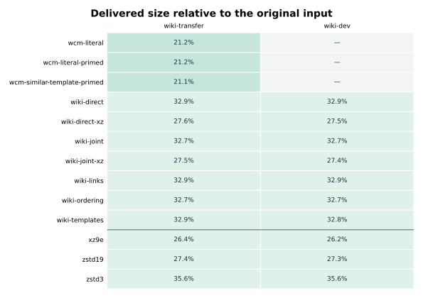

# Wikipedia page order, algebraic templates and primed context mixing

> **Verdict: wins on real data.** Best: Wikipedia text, another 24 MiB, −20.0% vs xz -9e.
>
> Part of [chapter 5](../../report/5-text.md) of the [report](../../report/README.md). Terms: [glossary](../../report/glossary.md).

## Question

Wikipedia pages share templates and structure. Does grouping similar pages, or priming the compressor with typical page text, help?

## How it works


Pages are reordered or split into template slots, then compressed with xz or with several CM3 members primed with similar text.

<details><summary>Technical details</summary>

Does grouping structurally similar pages make their prose or mathematical slots cheaper to reproduce? Three original implementations survive in `lab/hutter/shapes9/wiki_order.py`, `wiki_templates.py` and `wiki_archive.py`. The last uses the multi-member CM3 container from `lab/arena/cm3_parallel.py`. This folder includes the transforms, original WCM1 and C3P1 containers and a separate selector that prices the representations with Zstandard or XZ.

**Mechanism and test.** Similar pages share syntax, and arithmetic slots can predict numeric fields. Partial pages and exceptions must survive reconstruction. A disjoint transfer window tests whether gains persist beyond development text.

- Reorder complete pages by title or by deterministic similarity of title and article terms. Original increasing page IDs restore their order without transmitting a permutation. Partial pages and the outer envelope retain their positions.
- Parse repeated line templates with integer, percentage and link slots. Encode the slot literally, predict it from earlier values, or use a sum, difference or percentage of other known columns. The template dictionary, column parameters, escapes and line schedule travel in the stream.
- Replace a wiki link target by an index into recoverable article titles or a transmitted vocabulary. The decoder receives exact byte gaps and finds the same title list in the remaining text. This additional view pays the cost of each gap and symbol.
- WKS1 prices these alternatives in 8 MiB banks with Zstandard 6. Its XZ profile reprices the strongest two quick candidates and the original bank. WCM1 instead applies a single specified transform and embeds C3P1, which hashes its binary and configuration. Priming encodes one 65,536-byte prefix and lets the other four CM3 members learn from it.

</details>

## Results on 20 MiB inputs

Every archive below decoded byte-exact. *Our archive* is this project's own format. *Our transform → standard tool* reshapes the bytes reversibly and hands the result to gzip, zstd or xz; it is listed only where it beats that same tool on the raw bytes. *Best standard tool* is the smallest of gzip, bzip2, xz, Zstandard, Brotli and PPMd (plus domain codecs for images, scans and video) on the raw bytes. *Difference* compares the better of our two columns with it; negative = ours is smaller.

| Input | Kind | Raw bytes | Our archive | Our transform → standard tool | Best standard tool | Difference |
|---|---|---:|---:|---:|---:|---:|
| Wikipedia text, 24 MiB | real | 25,165,824 | 6,894,633 (`wiki-joint-xz`) | — | 6,602,488 (xz -9e) | +4.4% |
| Wikipedia text, another 24 MiB | real | 25,165,824 | 5,312,277 (`wcm-similar-template-primed`) | — | 6,637,336 (xz -9e) | **−20.0%** |

<details><summary>All profiles, timings and entropy measurements</summary>

<!-- BEGIN generated project measurements -->

Each archive passed a byte-for-byte round trip. *Bytes saved* is raw size minus archive (and any reference the decoder needs). Timings are one run on a shared desktop.

These tables list every measured profile. The comparison with the best standard tool on each input (gzip, bzip2, xz, Zstandard, Brotli, PPMd and the domain codecs) is the Results table above.

### Archive comparison across inputs



Read down a column to compare methods on identical input. Lower is better. 100% is the raw file size. Where available, standard codecs appear below the dividing line. Near 100%, cells give the exact byte difference from raw (+ means larger). Below 0.1%, they give the exact delivered total. A dash means the combination was unmeasured.

This project's published large-file trials measure complete archives. The effect on gzip, Zstandard or XZ after an isolated preprocessing step is unmeasured here.

### wiki-transfer · 25,165,824 raw bytes

**Standalone archives**

| Profile | Archive bytes | Bytes saved vs raw | Encode (s) | Decode (s) | Peak KiB (encode / decode) |
|---|---:|---:|---:|---:|---:|
| `wcm-literal` | 5,345,330 | +19,820,494 | 622.259 | 457.686 | 156,828 / 155,716 |
| `wcm-literal-primed` | 5,331,459 | +19,834,365 | 530.381 | 355.850 | 158,576 / 158,324 |
| `wcm-similar-template-primed` | 5,312,277 | +19,853,547 | 385.008 | 267.342 | 255,292 / 164,160 |
| `wiki-direct` | 8,283,833 | +16,881,991 | 4.668 | 2.580 | 42,136 / 28,584 |
| `wiki-direct-xz` | 6,939,917 | +18,225,907 | 117.327 | 3.944 | 153,116 / 45,916 |
| `wiki-joint` | 8,223,878 | +16,941,946 | 141.622 | 4.088 | 150,268 / 65,240 |
| `wiki-joint-xz` | 6,915,857 | +18,249,967 | 414.619 | 4.148 | 238,100 / 64,804 |
| `wiki-links` | 8,283,833 | +16,881,991 | 18.252 | 1.937 | 83,400 / 28,536 |
| `wiki-ordering` | 8,229,885 | +16,935,939 | 27.888 | 4.423 | 89,432 / 43,944 |
| `wiki-templates` | 8,275,996 | +16,889,828 | 34.759 | 4.647 | 118,376 / 65,064 |

Same-input baseline archives (bytes) · XZ 9 extreme 6,637,336 · Zstandard 19 6,891,038 · Zstandard 3 8,968,456

[Input hash and all measured codecs](../large-scale/results/by-dataset.md#wiki-transfer)

### wiki-dev · 25,165,824 raw bytes

**Standalone archives**

| Profile | Archive bytes | Bytes saved vs raw | Encode (s) | Decode (s) | Peak KiB (encode / decode) |
|---|---:|---:|---:|---:|---:|
| `wiki-direct` | 8,267,789 | +16,898,035 | 7.195 | 0.675 | 41,376 / 28,780 |
| `wiki-direct-xz` | 6,914,621 | +18,251,203 | 122.199 | 4.046 | 154,980 / 44,424 |
| `wiki-joint` | 8,223,663 | +16,942,161 | 134.533 | 7.488 | 153,444 / 64,308 |
| `wiki-joint-xz` | 6,894,633 | +18,271,191 | 428.699 | 4.826 | 243,688 / 68,432 |
| `wiki-links` | 8,267,789 | +16,898,035 | 18.458 | 2.132 | 86,300 / 28,700 |
| `wiki-ordering` | 8,233,638 | +16,932,186 | 26.717 | 2.848 | 86,912 / 44,824 |
| `wiki-templates` | 8,255,626 | +16,910,198 | 26.716 | 2.496 | 107,836 / 64,928 |

Same-input baseline archives (bytes) · XZ 9 extreme 6,602,488 · Zstandard 19 6,873,848 · Zstandard 3 8,951,574

[Input hash and all measured codecs](../large-scale/results/by-dataset.md#wiki-dev)

### Reproduce the large-file comparison

From the repository root, with the pinned inputs and project dependencies installed, replay all published standalone profiles for this folder into a fresh directory.

```sh
python3 research/large-scale/primary.py runs/replay-wiki-structures --project wiki-structures --all-profiles
```

[Dataset preparation](../large-scale/README.md#inputs) · [Archive hashes and settings](../large-scale/results/archives.jsonl)

<!-- END generated project measurements -->

</details>

## Small-scale results

Two disjoint 24 MiB enwik8 slices are fixed in the input manifest. The second slice starts at byte 67,108,864 and contains partial pages at the boundaries. Every measured profile includes a separate decoder process and a complete byte comparison. See the [source and archive hashes](../large-scale/results/archives.jsonl).

At Zstandard 6 the joint selector used 8,223,663 bytes on the first slice versus 8,267,789 for the matched direct representation. On the second slice it used 8,223,878 versus 8,283,833. Ordering alone used 8,229,885 on that second slice. The standalone link view selected the unmodified representation in every bank of both slices. Whole-file XZ extreme and the tested CM3 models produce smaller text archives. [All profiles by input](../large-scale/results/by-dataset.md#wiki-transfer)

On the disjoint 25,165,824-byte Wikipedia transfer window, four independently decodable CM3 members used 5,345,330 bytes in total. Encoding the first 65,536 source bytes as a primer, then using those decoded bytes to initialize the body members, reduced the complete archive to 5,331,459 bytes. Applying the historical page-similarity ordering and arithmetic template transform with the same priming produced 5,312,277 bytes, another 19,182 bytes saved. [Measured sizes and profiles](../large-scale/results/by-dataset.md#wiki-transfer)

## Run it

```sh
python3 research/wiki-structures/codec.py encode runs/large/raw/wiki-transfer runs/wiki.wks --profile joint
python3 research/wiki-structures/codec.py decode runs/wiki.wks runs/wiki.restored
cmp runs/large/raw/wiki-transfer runs/wiki.restored
python3 research/large-scale/bench.py runs/large/raw/wiki-transfer runs/primed.jsonl wcm-literal wcm-literal-primed wcm-similar-template-primed
```
