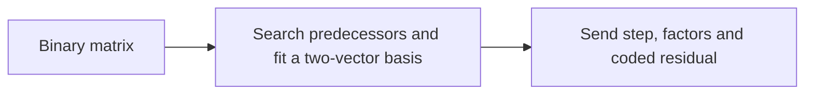
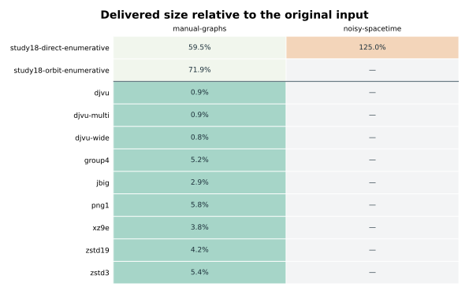

# Automata, factors and residual coding

> **Verdict: loses on real data.** Best real input: Scanned manual: Graphviz guides, 76.7× larger vs DjVu.
>
> Part of [chapter 2](../../report/2-dynamics.md) of the [report](../../report/README.md). Terms: [glossary](../../report/glossary.md).

## Question

Experiments 06, 07, 08 and 14 combined: with the factor model held fixed, does undoing an automaton step make the residual cheaper?

## How it works



The same factorization and residual coder run with and without an automaton step in front, and with direct or enumerative residual coding.

<details><summary>Technical details</summary>

Does undoing an automaton step reduce residual cost when the factor model stays fixed?

**Mechanism and test.** A lower error weight can improve subset coding while leaving long or irregular gaps. Switching the residual coder with the orbit held fixed tests whether the gain comes from the fit or from the mask representation.

Fit two GF(2) basis vectors per eight-row matrix using experiment 08. The orbit profiles consider up to three reverse Checkerboard steps from experiment 06. Rank from experiment 07 breaks ties after residual weight. Send the selected step, basis, coordinates and a nested experiment 14 residual archive. First compare direct and orbit prediction with enumerative coding. Then hold orbit selection fixed while switching among enumeration, Rice gaps, contexts and per-block selection.

</details>

## Results on 20 MiB inputs

Every archive below decoded byte-exact. *Our archive* is this project's own format. *Our transform → standard tool* reshapes the bytes reversibly and hands the result to gzip, zstd or xz; it is listed only where it beats that same tool on the raw bytes. *Best standard tool* is the smallest of gzip, bzip2, xz, Zstandard, Brotli and PPMd (plus domain codecs for images, scans and video) on the raw bytes. *Difference* compares the better of our two columns with it; negative = ours is smaller.

| Input | Kind | Raw bytes | Our archive | Our transform → standard tool | Best standard tool | Difference |
|---|---|---:|---:|---:|---:|---:|
| Scanned manual: Graphviz guides | real | 24,642,792 | 14,653,191 (`study18-direct-enumerative`) | — | 191,132 (DjVu) | 76.7× larger |
| 4-D noisy field from a hidden automaton | planted | 25,165,824 | 31,450,511 (`study18-direct-enumerative`) | — | — | — |

<details><summary>All profiles, timings and entropy measurements</summary>

<!-- BEGIN generated project measurements -->

Each archive passed a byte-for-byte round trip. *Bytes saved* is raw size minus archive (and any reference the decoder needs). Timings are one run on a shared desktop.

These tables list every measured profile. The comparison with the best standard tool on each input (gzip, bzip2, xz, Zstandard, Brotli, PPMd and the domain codecs) is the Results table above.

### Archive comparison across inputs



Read down a column to compare methods on identical input. Lower is better. 100% is the raw file size. Where available, standard codecs appear below the dividing line. Near 100%, cells give the exact byte difference from raw (+ means larger). Below 0.1%, they give the exact delivered total. A dash means the combination was unmeasured.

This project's published large-file trials measure complete archives. The effect on gzip, Zstandard or XZ after an isolated preprocessing step is unmeasured here.

### manual-graphs · 24,642,792 raw bytes

**Standalone archives**

| Profile | Archive bytes | Bytes saved vs raw | Encode (s) | Decode (s) | Peak KiB (encode / decode) |
|---|---:|---:|---:|---:|---:|
| `study18-direct-enumerative` | 14,653,191 | +9,989,601 | 65.912 | 95.317 | 25,252 / 23,828 |
| `study18-orbit-enumerative` | 17,725,221 | +6,917,571 | 288.920 | 58.864 | 25,120 / 23,664 |

Same-input baseline archives (bytes) · DjVu 214,067 · DjVu (separated foreground) 213,732 · DjVu (wide strips) 191,132 · CCITT Group 4 1,270,850 · JBIG 707,797 · 1-bit PNG 1,418,635 · XZ 9 extreme 930,864 · Zstandard 19 1,034,431 · Zstandard 3 1,325,134

[Input hash and all measured codecs](../../research/large-scale/results/by-dataset.md#manual-graphs)

### noisy-spacetime · 25,165,824 raw bytes

**Standalone archives**

| Profile | Archive bytes | Bytes saved vs raw | Encode (s) | Decode (s) | Peak KiB (encode / decode) |
|---|---:|---:|---:|---:|---:|
| `study18-direct-enumerative` | 31,450,511 | -6,284,687 | 761.297 | 563.380 | 25,096 / 23,492 |

[Input hash and all measured codecs](../../research/large-scale/results/by-dataset.md#noisy-spacetime)

### Reproduce the large-file comparison

From the repository root, with the pinned inputs and project dependencies installed, replay all published standalone profiles for this folder into a fresh directory.

```sh
python3 research/large-scale/primary.py runs/replay-automaton-factor-residual --project automaton-factor-residual --all-profiles
```

[Dataset preparation](../../research/large-scale/README.md#inputs) · [Archive hashes and settings](../../research/large-scale/results/archives.jsonl)

<!-- END generated project measurements -->

</details>

## Small-scale results

The planted control evolves noisy rank-two matrices. The real controls are a fax window and medical-image bytes. Transform selection minimizes residual weight with a fixed tie rule. Every residual profile sees the same chosen factors for an orbit input.

The following table records the original small diagnostic. The primary benchmark follows it.

With enumeration fixed, the orbit reduced the evolved control from 475 bytes to 339. Holding that prediction fixed, Rice used 350 bytes and the context code used 355.

| Input | Profile | Raw bytes | Archive | Archive plus required base | Zstd |
|---|---|---:|---:|---:|---:|
| evolved-noisy-rank-two | direct-enumerative | 384 | 475 | 475 | 397 |
| evolved-noisy-rank-two | orbit-enumerative | 384 | 339 | 339 | 397 |
| evolved-noisy-rank-two | orbit-rice | 384 | 350 | 350 | 397 |
| evolved-noisy-rank-two | orbit-context | 384 | 355 | 355 | 397 |
| evolved-noisy-rank-two | orbit-adaptive | 384 | 351 | 351 | 397 |
| uniform | direct-enumerative | 384 | 509 | 509 | 397 |
| uniform | orbit-enumerative | 384 | 537 | 537 | 397 |
| uniform | orbit-rice | 384 | 554 | 554 | 397 |
| uniform | orbit-context | 384 | 577 | 577 | 397 |
| uniform | orbit-adaptive | 384 | 549 | 549 | 397 |
| fax-mid.bin | direct-enumerative | 512 | 313 | 313 | 80 |
| fax-mid.bin | orbit-enumerative | 512 | 377 | 377 | 80 |
| fax-mid.bin | orbit-rice | 512 | 393 | 393 | 80 |
| fax-mid.bin | orbit-context | 512 | 425 | 425 | 80 |
| fax-mid.bin | orbit-adaptive | 512 | 393 | 393 | 80 |
| medical.bin | direct-enumerative | 512 | 353 | 353 | 137 |
| medical.bin | orbit-enumerative | 512 | 417 | 417 | 137 |
| medical.bin | orbit-rice | 512 | 433 | 433 | 137 |
| medical.bin | orbit-context | 512 | 460 | 460 | 137 |
| medical.bin | orbit-adaptive | 512 | 433 | 433 | 137 |

All 20 study archives reconstructed their original bytes. The [trial table](results/reference/trials.csv) includes input hashes, side-stream byte counts and single-run timings. [Study implementation](benchmark.py).

## Run it

Run from the repository root on Linux with Python and the Zstd CLI.

```sh
python3 studies/run.py automaton-factor-residual runs/automaton-factor-residual
```
