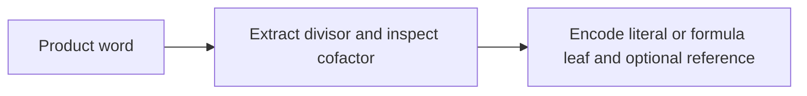
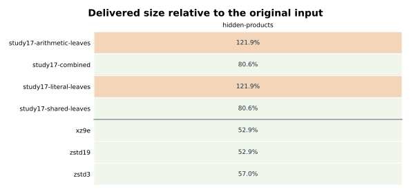

# Formula leaves, factors and grammar references

> **Verdict: planted data only.** Planted control: Products hiding a repdigit factor, +53.5% vs brotli -11.
>
> Part of [chapter 1](../../report/1-formulas.md) of the [report](../../report/README.md). Terms: [glossary](../../report/glossary.md).

## Question

Experiments 01, 02 and 11 combined: when a factor already has a short repdigit recipe, does a dictionary of shared factors still add anything?

## How it works



Products hiding a repdigit factor are coded with factor leaves stored literally, as recipes, as shared recipes, or both.

<details><summary>Technical details</summary>

How much does a shared-factor dictionary add when the factor itself already has a short repdigit recipe?

**Mechanism and test.** A factor can expose a recipe hidden in the original word. Repeated cofactors can then amortize their first description. The four profiles separate the cost of formula leaves from the gain of sharing.

All four profiles use the same small-divisor search and product tree. Each 16-byte input word is represented by the first fitting divisor and its cofactor. Experiment 02 supplies literal operand coding. Experiment 01 supplies the bounded direct/ratio catalog and arithmetic inverse. The sharing profiles intern cofactor values at first occurrence using experiment 11’s reference token encoding. Each leaf has an operator tag. Only shared profiles build the dictionary, which the decoder reconstructs in order.

</details>

## Results on 20 MiB inputs

Every archive below decoded byte-exact. *Our archive* is this project's own format. *Our transform → standard tool* reshapes the bytes reversibly and hands the result to gzip, zstd or xz; it is listed only where it beats that same tool on the raw bytes. *Best standard tool* is the smallest of gzip, bzip2, xz, Zstandard, Brotli and PPMd (plus domain codecs for images, scans and video) on the raw bytes. *Difference* compares the better of our two columns with it; negative = ours is smaller.

| Input | Kind | Raw bytes | Our archive | Our transform → standard tool | Best standard tool | Difference |
|---|---|---:|---:|---:|---:|---:|
| Products hiding a repdigit factor | planted | 25,165,824 | 20,296,188 (`study17-combined`) | — | 13,226,527 (brotli -11) | +53.5% |

<details><summary>All profiles, timings and entropy measurements</summary>

<!-- BEGIN generated project measurements -->

Each archive passed a byte-for-byte round trip. *Bytes saved* is raw size minus archive (and any reference the decoder needs). Timings are one run on a shared desktop.

These tables list every measured profile. The comparison with the best standard tool on each input (gzip, bzip2, xz, Zstandard, Brotli, PPMd and the domain codecs) is the Results table above.

### Archive comparison across inputs



Read down a column to compare methods on identical input. Lower is better. 100% is the raw file size. Where available, standard codecs appear below the dividing line. Near 100%, cells give the exact byte difference from raw (+ means larger). Below 0.1%, they give the exact delivered total. A dash means the combination was unmeasured.

This project's published large-file trials measure complete archives. The effect on gzip, Zstandard or XZ after an isolated preprocessing step is unmeasured here.

### hidden-products · 25,165,824 raw bytes

**Standalone archives**

| Profile | Archive bytes | Bytes saved vs raw | Encode (s) | Decode (s) | Peak KiB (encode / decode) |
|---|---:|---:|---:|---:|---:|
| `study17-arithmetic-leaves` | 30,671,807 | -5,505,983 | 34.754 | 41.183 | 25,016 / 23,652 |
| `study17-combined` | 20,296,188 | +4,869,636 | 58.633 | 54.326 | 24,956 / 23,744 |
| `study17-literal-leaves` | 30,671,807 | -5,505,983 | 38.258 | 42.369 | 25,136 / 23,712 |
| `study17-shared-leaves` | 20,296,188 | +4,869,636 | 44.296 | 31.073 | 24,908 / 23,500 |

Same-input baseline archives (bytes) · XZ 9 extreme 13,309,788 · Zstandard 19 13,318,271 · Zstandard 3 14,343,987

[Input hash and all measured codecs](../../research/large-scale/results/by-dataset.md#hidden-products)

### Reproduce the large-file comparison

From the repository root, with the pinned inputs and project dependencies installed, replay all published standalone profiles for this folder into a fresh directory.

```sh
python3 research/large-scale/primary.py runs/replay-formula-factor-grammar --project formula-factor-grammar --all-profiles
```

[Dataset preparation](../../research/large-scale/README.md#inputs) · [Archive hashes and settings](../../research/large-scale/results/archives.jsonl)

<!-- END generated project measurements -->

</details>

## Small-scale results

The planted file contains 80 products built from four repeating quotient leaves. A cofactor window and an equal-sized random control provide comparison inputs. The study shares factor leaves. A deeper product-tree search would test additional kinds of reuse.

The following table records the original small diagnostic. The primary benchmark follows it.

Sharing alone used 303 bytes on the planted input. Enabling arithmetic leaves as well reduced it to 264 bytes. Arithmetic without shared references used 492 bytes.

| Input | Profile | Raw bytes | Archive | Archive plus required base | Zstd |
|---|---|---:|---:|---:|---:|
| shared-quotient-factors | literal-leaves | 1280 | 1273 | 1273 | 153 |
| shared-quotient-factors | arithmetic-leaves | 1280 | 492 | 492 | 153 |
| shared-quotient-factors | shared-leaves | 1280 | 303 | 303 | 153 |
| shared-quotient-factors | combined | 1280 | 264 | 264 | 153 |
| uniform | literal-leaves | 1280 | 1726 | 1726 | 1293 |
| uniform | arithmetic-leaves | 1280 | 1726 | 1726 | 1293 |
| uniform | shared-leaves | 1280 | 1726 | 1726 | 1293 |
| uniform | combined | 1280 | 1726 | 1726 | 1293 |
| real-cofactor-words | literal-leaves | 512 | 697 | 697 | 525 |
| real-cofactor-words | arithmetic-leaves | 512 | 697 | 697 | 525 |
| real-cofactor-words | shared-leaves | 512 | 697 | 697 | 525 |
| real-cofactor-words | combined | 512 | 697 | 697 | 525 |

All 12 study archives reconstructed their original bytes. The [trial table](results/reference/trials.csv) includes input hashes, side-stream byte counts and single-run timings. [Study implementation](benchmark.py).

## Run it

Run from the repository root on Linux with Python and the Zstd CLI.

```sh
python3 studies/run.py formula-factor-grammar runs/formula-factor-grammar
```
