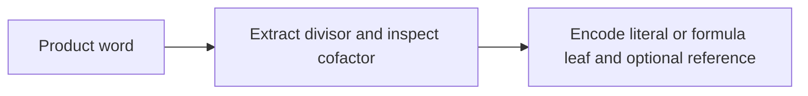

# Formula leaves, factors and grammar references

[Method diagram](#method-diagram) · [Charts and benchmark tables](#large-file-benchmark)

## Question and prior work

How much does a shared-factor dictionary add when the factor itself already has a short repdigit recipe?

## Run the experiment

Run from the repository root on Linux with Python and the Zstd CLI.

```sh
python3 studies/run.py formula-factor-grammar runs/formula-factor-grammar
```

## Variants and format

All four profiles use the same small-divisor search and product tree. Each 16-byte input word is represented by the first fitting divisor and its cofactor. Experiment 02 supplies literal operand coding. Experiment 01 supplies the bounded direct/ratio catalog and arithmetic inverse. The sharing profiles intern cofactor values at first occurrence using experiment 11’s reference token encoding. Each leaf has an operator tag. Only shared profiles build the dictionary, which the decoder reconstructs in order.

### Method diagram



**Mechanism and test.** A factor can expose a recipe hidden in the original word. Repeated cofactors can then amortize their first description. The four profiles separate the cost of formula leaves from the gain of sharing.

## Inputs and measurement

The planted file contains 80 products built from four repeating quotient leaves. A cofactor window and an equal-sized random control provide comparison inputs. The study shares factor leaves. A deeper product-tree search would test additional kinds of reuse.

## Results

The following table records the original small diagnostic. The primary benchmark follows it.

Sharing alone used 303 bytes on the planted input. Enabling arithmetic leaves as well reduced it to 264 bytes. Arithmetic without shared references used 492 bytes.

| Input | Profile | Raw bytes | Archive | Archive plus required base | Zstd |
|---|---|---:|---:|---:|---:|
| shared-quotient-factors | literal-leaves | 1280 | 1273 | 1273 | 153 |
| shared-quotient-factors | arithmetic-leaves | 1280 | 492 | 492 | 153 |
| shared-quotient-factors | shared-leaves | 1280 | 303 | 303 | 153 |
| shared-quotient-factors | combined | 1280 | 264 | 264 | 153 |
| uniform | literal-leaves | 1280 | 1726 | 1726 | 1293 |
| uniform | arithmetic-leaves | 1280 | 1726 | 1726 | 1293 |
| uniform | shared-leaves | 1280 | 1726 | 1726 | 1293 |
| uniform | combined | 1280 | 1726 | 1726 | 1293 |
| real-cofactor-words | literal-leaves | 512 | 697 | 697 | 525 |
| real-cofactor-words | arithmetic-leaves | 512 | 697 | 697 | 525 |
| real-cofactor-words | shared-leaves | 512 | 697 | 697 | 525 |
| real-cofactor-words | combined | 512 | 697 | 697 | 525 |

All 12 study archives reconstructed their original bytes. The [trial table](results/reference/trials.csv) includes input hashes, side-stream byte counts and single-run timings. [Study implementation](benchmark.py).

## Large-file benchmark

On `hidden-products` (25,165,824 raw bytes), `study17-combined` produced 20,296,188 archive bytes. Zstandard level 3 used 14,343,987 bytes on the same input. [Input and timing](../../research/large-scale/results/by-dataset.md#hidden-products) · [All project measurements](../../research/large-scale/results/by-experiment.md#formula-factor-grammar)

<!-- BEGIN generated project measurements -->

Each archive passed a byte-for-byte round trip. Bytes saved subtracts the archive and any required reference from the raw input size. Timings are seconds from one run.

On the primary input `hidden-products`, `study17-combined` delivers 20,296,188 bytes, 5,952,201 bytes larger than standalone Zstandard 3 (14,343,987 bytes).

### Archive comparison across inputs


Read down a column to compare methods on identical input. Lower is better. 100% is the raw file size. Where available, standard codecs appear below the dividing line. Near 100%, cells give the exact byte difference from raw (+ means larger). Below 0.1%, they give the exact delivered total. A dash means the combination was unmeasured.

This project's published large-file trials measure complete archives. The effect on gzip, Zstandard or XZ after an isolated preprocessing step is unmeasured here.

### hidden-products · 25,165,824 raw bytes

**Standalone archives**

| Profile | Archive bytes | Bytes saved vs raw | Encode (s) | Decode (s) | Peak KiB (encode / decode) |
|---|---:|---:|---:|---:|---:|
| `study17-arithmetic-leaves` | 30,671,807 | -5,505,983 | 34.754 | 41.183 | 25,016 / 23,652 |
| `study17-combined` | 20,296,188 | +4,869,636 | 58.633 | 54.326 | 24,956 / 23,744 |
| `study17-literal-leaves` | 30,671,807 | -5,505,983 | 38.258 | 42.369 | 25,136 / 23,712 |
| `study17-shared-leaves` | 20,296,188 | +4,869,636 | 44.296 | 31.073 | 24,908 / 23,500 |

Same-input baseline archives (bytes) · XZ 9 extreme 13,309,788 · Zstandard 19 13,318,271 · Zstandard 3 14,343,987

[Input hash and all measured codecs](../../research/large-scale/results/by-dataset.md#hidden-products)

### Reproduce the large-file comparison

From the repository root, with the pinned inputs and project dependencies installed, replay all published standalone profiles for this folder into a fresh directory.

```sh
python3 research/large-scale/primary.py runs/replay-formula-factor-grammar --project formula-factor-grammar --all-profiles
```

[Dataset preparation](../../research/large-scale/README.md#inputs) · [Archive hashes and settings](../../research/large-scale/results/archives.jsonl)

<!-- END generated project measurements -->

## Connections

[Shared formulas inside a factor tree](../../research/shared-factor-forest/README.md) · [Whiteboard quotients inside factor trees](../../research/whiteboard-trees/README.md)
